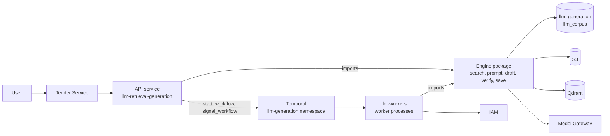
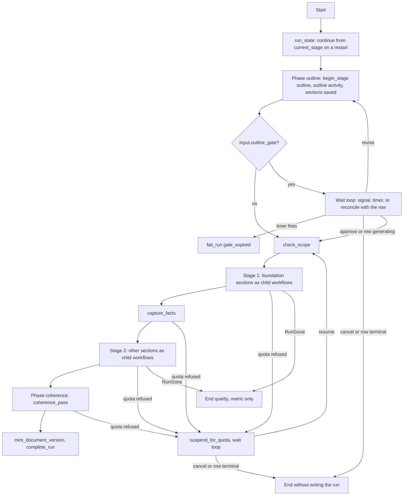
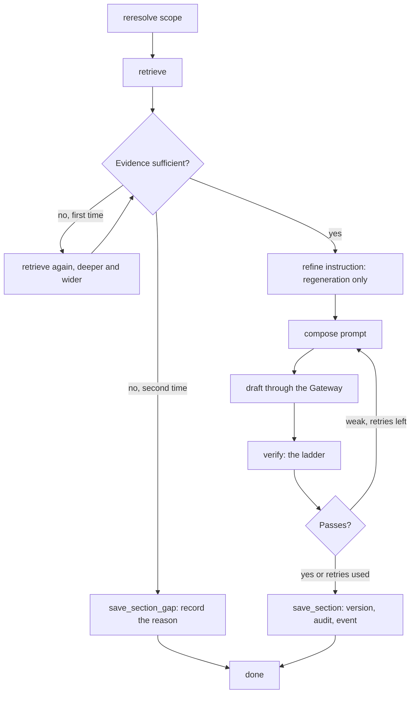

# Architecture

This document describes the structure, dependency rules and runtime flows of `llm-workers`. The design is [`docs/lld/llm-lld-workers-service.md`](docs/lld/llm-lld-workers-service.md); this file says how the code is laid out to meet it. Where each rule is built and tested: [`docs/lld-traceability.md`](docs/lld-traceability.md). Per-module purpose, assumptions and security notes: [`docs/module-map.md`](docs/module-map.md).

`llm-workers` is a **private Python worker service** (`github.com/BCBP-SOLUTIONS-FZC-LLC/llm-workers`, Python 3.15+, Temporal Python SDK, LangGraph) with **no API**: it exposes `/health`, `/live`, `/ready` and Prometheus metrics only. Everything a user can do reaches it through the API service (`llm-retrieval-generation`), which validates the request, saves a run row and starts or signals a Temporal workflow. This service executes the workflow and writes its results into the same database the API service reads.

It is the generation and extraction deployment of the Worker Pool, one of four planned deployables of the LLM subsystem (HLD §5, MD-03): Ingestion, Retrieval & Generation, **Worker Pool** (this repo) and Model Gateway. Ingestion's workers are a separate deployment (LLD D-4, I-1); only the generation deployment exists here.

**Does not own:** API routes, admission and validation (API service); the schema and migrations (API service); the reusable building blocks and every table write (`rag.engine`, imported as a pinned package); ingestion and re-index workflows (Ingestion); model routing, credentials, residency and quota accounting (Model Gateway); the Temporal cluster (Workflow Engine team); users, tenants and roles (IAM).

---

## Components

> Source: LLD §3.1



The engine is **code, not a running service**: it runs inside whichever process imports it, the API pods for the short routes and the worker pods for long runs.

## Repository layout

Follows LLD §3.2, not clean architecture. One `uv` workspace, one member per deployment:

```
pyproject.toml, uv.lock          workspace root, locked
generation/                      this deployment: generation and extraction workers
  pyproject.toml                 requires-python 3.15; pins the engine (rag.engine + llm_models.workers)
  src/llm_workers_generation/
    workflows/                   GenerationWorkflow, SectionWorkflow, ExtractionWorkflow, TenantSlots
    activities/                  activity wrappers and the orchestration steps; the EngineApi port
    graphs/                      the section graph (LangGraph), built on the engine's building blocks
    codec/                       the payload codec and the failure converter
    queues.py                    work queue names, control queue names and the selector
    worker.py                    bootstrap per queue (a work worker and a control worker)
    versioning/                  deployment config, patch markers, replay
    observability/               metrics, tracing runtime, health probes
    operator/                    audited operator commands
    tuning.py, errors.py, types.py, config.py
  tests/
Dockerfile                       the service image (repository root)
deploy/                          helm/ (one Deployment per queue)
docs/                            LLD, ADRs, module map, traceability
```

`ingestion/` is not present; the workspace is laid out so the Ingestion deployment can join with its own settings.

## Layer rules

Enforced by `generation/tests/unit/test_architecture.py`.

| # | Rule |
|---|---|
| WD-1 | `workflows/` imports only the standard library, `temporalio`, `llm_models.workers` and a short list of sandbox-safe own modules. Nothing that touches a database, S3, HTTP or the clock. This is what lets the Temporal sandbox replay the code |
| WD-2 | `activities/` imports `temporalio.activity`, the engine's **public API** and the plain types. It never imports engine internals |
| WD-3 | No SQL, `asyncpg`, `boto3`, `qdrant_client` or raw HTTP client. Every read and write goes through the engine |
| WD-4 | The engine never imports this repo and has no `temporalio` dependency |
| WD-5 | Logs, traces and the activity-side metrics go through `platform-fastapicommon`; never `logging`, `structlog`, `prometheus_client` or `opentelemetry`. **Two named exceptions:** Temporal SDK telemetry, and the 9 workflow-side metrics (workflow code keeps the SDK's workflow logger and `workflow.metric_meter()` and never imports fastapicommon). ADR-0006 |
| WD-6 | Nothing logs or labels content |
| WD-7 | `temporalio.activity` and `temporalio.workflow` imports are confined to `activities/` and `workflows/` |

Hexagonal at the engine boundary: activities depend on the `EngineApi` `Protocol` (`activities/ports.py`). `activities/engine_api.py` (`RagEngineApi`) is the **only module that imports `rag`**; the tests use `FakeEngineApi`. See ADR-0001.

## Process model

One worker process polls **one work queue** (kind and tier) and runs both workflow tasks and activity tasks. It also runs a second, **activity-only worker on that queue's `-control` queue** with its own slots, so a run-state write is never queued behind ten-minute section activities (LW-16). One Kubernetes Deployment per queue lets each scale on its own backlog.

| Kind | Standard | Enterprise | Strict residency |
|---|---|---|---|
| Generation | `llm-generation` | `llm-generation-enterprise` | `llm-generation-strict` |
| Extraction | `llm-extraction` | `llm-extraction-enterprise` | `llm-extraction-strict` |

`task_queue_for(kind, plan, residency_mode)` is the one selector: strict wins, then enterprise, else standard.

## The engine boundary

The reusable work (search, prompt, draft, verify, every table write) is `rag.engine`, versioned and pinned. This repo owns the workflows, the section graph, the orchestration activities and the wrappers. The activities call the engine only through the allowed functions (LLD §4.2). Errors cross the boundary as typed engine errors and are translated **once**, in `activities/_guard.py`: `RunGone`, `RunTerminal` and `QuotaRefused` become result flags; everything else becomes `ApplicationError(type, fixed message)` with no details and no chaining.

**Engine 1.1.0** (tag `engine-v1.1.0`) closed ADR-0003 gaps 1 to 5: the pack's `outline_skeletons` and `fact_keys` (an assumed Tender contract), `load_section_text` (a read failure is `ContentUnavailable`, retryable and bounded), the exported prompt, evidence and verification types, and `fail_run` from `pending`, `outline_building` and `suspended`. **Gap 6** (the engine's metrics identity, engine 1.2.0, not adopted) is open, so the engine's own metrics are off in a worker. See [`docs/adr/0003-engine-api-gaps.md`](docs/adr/0003-engine-api-gaps.md).

## Workflows

> Source: LLD §6.1



- **`GenerationWorkflow`**: the phases above. A regeneration (`origin = regeneration`) skips the outline and the gate. A restart reads the row first and continues from `current_stage`.
- **`SectionWorkflow`**: one per section, its own history. Acquires the tenant's slot, runs `write_section`, releases the slot in a `finally`.
- **`ExtractionWorkflow`**: `run_state`, `begin_stage(extract)`, `run_extraction`; quota suspends and repeats the step.
- **`TenantSlots`**: one long-lived entity workflow per tenant per queue (`slots:{queue}:{tenant_id}`), reached by update-with-start: FIFO grants up to `FANOUT_MAX_PER_TENANT`, expiring leases, continue-as-new when Temporal suggests it. Section children poll for a slot with a 2 s activity and sleep on a workflow timer between polls (ADR-0005).

**A signal is a hint, the row is the truth.** Every wait (the gate, the suspension) wakes on a signal or every `WAIT_RECONCILE_SECONDS` and reads `run_state`, so a lost signal costs at most one interval (WW-1). `cancel` ends the workflow **without writing the run**: the API service wrote the edges.

## The section graph

> Source: LLD §7.3



The graph runs to completion **inside one activity** with **no LangGraph checkpointer**. Content (chunks, prompts, drafts) lives on the `SectionSteps` object in memory and never in graph state; a checkpoint row holds node names, timings and counts only (`record_checkpoint`).

## Determinism and versioning

Workflow code never reads the clock, randomness, threads or environment, and issues no I/O. Workflow-affecting numbers live in `tuning.py` (ADR-0004). A change to the order or number of commands needs a `workflow.patched` marker (`versioning/patches.py`) and a replay that still passes. Each work queue is one **Worker Deployment** (named for the queue, build id = image tag, engine tag inside); `GenerationWorkflow` and `TenantSlots` auto-upgrade, `SectionWorkflow` and `ExtractionWorkflow` are pinned.

## Quota, scope and failure

- **Quota** is a result, not a failure: a refused model-calling step returns `quota_suspended`, the run suspends at that phase after in-flight work finishes, and the same phase repeats on resume. The suspension's clock is `suspended_at` on the row.
- **Scope** is re-resolved before any corpus read (per section, and in the outline, facts and coherence activities). An empty scope ends the run `scope_revoked`; completed sections stay durable.
- **A section failure**: stage 1 fails the run with the sections' own reason; stage 2 leaves the section `failed` and the run `complete`. A run deadline and a poison-section breaker stop a run that cannot finish.
- **A terminal write that cannot be recorded** is retried for 60 minutes, then the workflow fails visibly with `UnrecordedFailure` and an alert (LLD §13.2).
- **A purged run** (`RunGone`) ends the workflow quietly with a metric.

## Security

No readable content crosses into Temporal history: identifiers, enums and counts only in input, signals, results, failures and heartbeats. Every payload is AES-256-GCM encrypted (`codec/`) and failure attributes are encoded by the same codec. Tenant isolation is the engine's (row-level security under the activity role); this service binds the run's identity per activity and never takes scope from the run input or a signal. Details: LLD §14, `docs/module-map.md`.

## Observability

- **Logs and traces:** `platform-fastapicommon` (`configure_logging`, `init_tracing`); the stdlib `temporalio` loggers come out in the same format. Workflow code keeps the SDK's workflow logger.
- **Ops server** (`observability/ops.py`, `HEALTH_PORT`, default 8080): a small FastAPI app with fastapicommon's health router (`/health`, `/live`, `/ready`) and metrics router (`/metrics`), run by `uvicorn.Server.serve()` as one task in the worker's loop. `/ready` is true while the Temporal connection is up and both workers poll, and goes 503 first when the worker is told to stop; the server itself stops after the drain. **Runbook:** a draining pod leaves its workflow RUNNING for another pod to continue; do not terminate or reset the run.
- **Metrics (25 in the LLD, 20 built):** 11 activity-side metrics are fastapicommon Tier 3 collectors named `llm_workers_*` (`observability/app_metrics.py`), served at `/metrics` next to `platform_*`. 9 workflow-side metrics stay on Temporal's `workflow.metric_meter()` (`observability/metrics.py`), and the Temporal `Runtime` also serves the SDK's own telemetry: both on `METRICS_BIND_ADDRESS` (9464). These are the two named exceptions to "metrics through fastapicommon". Two scrape targets exist today; whether to keep two, merge or push over OTLP is open ([ADR-0006](docs/adr/0006-environment-and-deviations.md)). Labels come from a bounded allow-list (no tenant, user or document id). The Observability Standard is applied: every metric is Tier 3, `domain`, `service` and `environment` are set on both endpoints (`observability/setup.py::platform_labels`), and `make metrics-lint` runs the platform linter over the real scrape of both; the SDK's `temporal_*` names are a named exception ([ADR-0006](docs/adr/0006-environment-and-deviations.md)). 5 metrics are not built (no truthful event) and the engine's own metrics are off in a worker.
- A tracing interceptor is on when `OTEL_EXPORTER_OTLP_ENDPOINT` is set. Alert rules, SLOs and runbooks are **not written yet** (LLD §15.4 to §15.6).

## Testing strategy

Unit, workflow (Temporal time-skipping), replay, security (a canary string must not reach any history or log), integration and engine contract tests; coverage gate 95%. The suites run against a fake engine; the contract tests run the real engine in a subprocess. See [`CONTRIBUTING.md`](CONTRIBUTING.md#testing-requirements).

## Deployment

A `Dockerfile` (repository root), a Helm chart (`deploy/helm/llm-workers`: one Deployment per queue, KEDA scaler on task-queue backlog, PDB, network policy) and CI/release workflows exist. The chart has been rendered and linted (`helm`), nothing else has run: the image is not built, the workflows have never run on GitHub and nothing was applied to a cluster. Pods spread across zones and drain within `WORKER_SHUTDOWN_GRACE_SECONDS`. See [`VERSIONING.md`](VERSIONING.md#planned-not-yet-in-place) for what is planned.

## Not built

Tracked in `docs/lld-traceability.md`: the zombie sweep and freeze pause (the API service and slice 7), load shedding, per-section residency re-read, alert rules, SLOs, runbooks, the DR drill, the codec server, a real-Postgres integration suite, continue-as-new for `GenerationWorkflow`.
