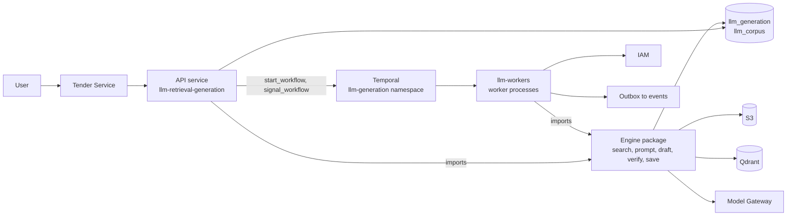
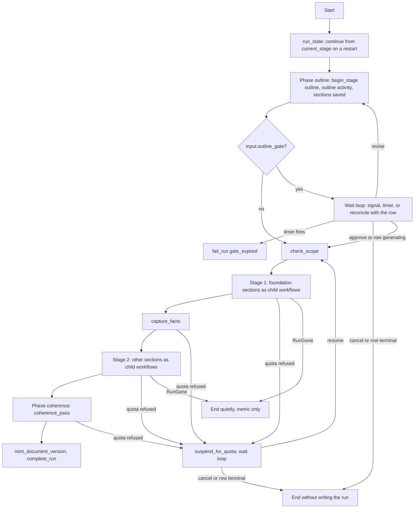
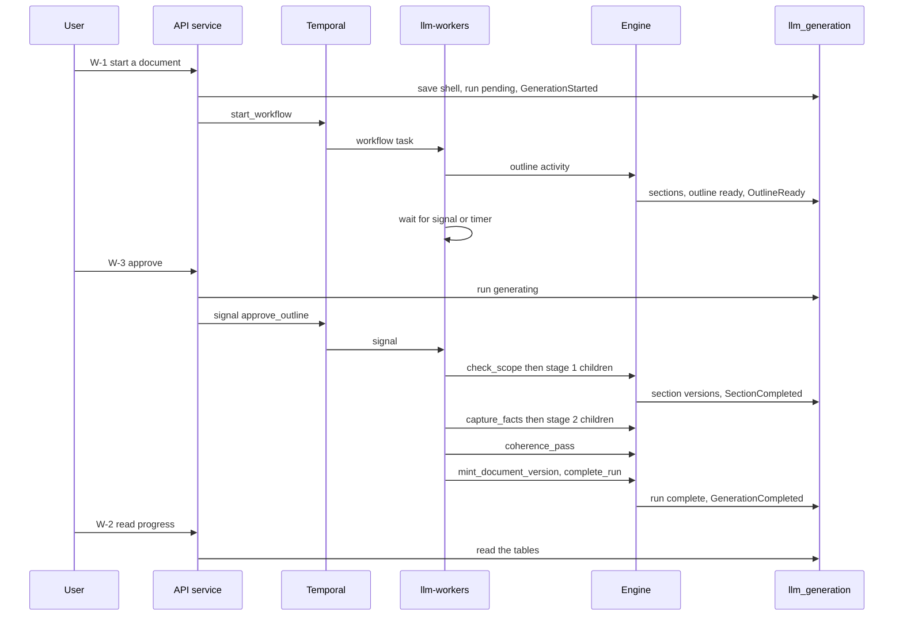
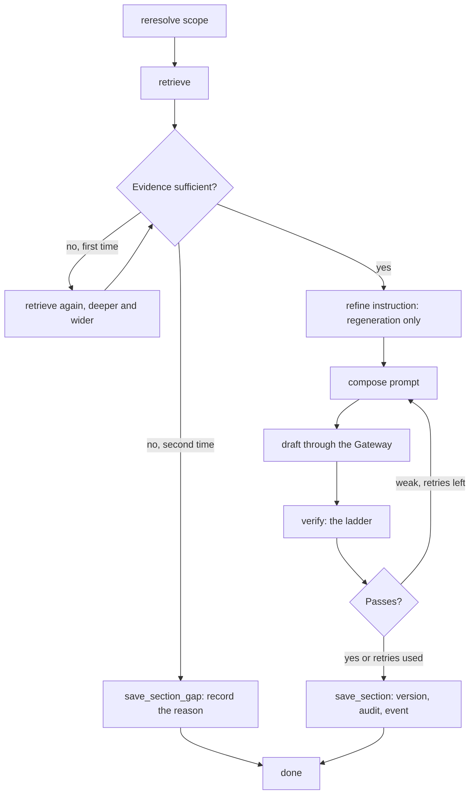

# llm-workers — Low-Level Design

## Tender Management SaaS Platform — LLM Subsystem

| Field | Value |
|---|---|
| Document type | Low-Level Design (LLD) |
| Service | `llm-workers` (the Worker Pool: the generation and extraction deployment) |
| Revision | **0.11**, 2026-11-27. Supersedes rev 0.10, rev 0.9, rev 0.8, rev 0.7, rev 0.6 and rev 0.5 (2026-11-26), rev 0.4 and rev 0.3 (2026-11-25), rev 0.2 (2026-11-23) and rev 0.1 (2026-11-18). Draft 2 for TL review |
| Base HLD | `LLM Service High-Level Design` v0.31, 2026-11-25 (§5.4 LLM Worker Pool, §4 data and write authority, §5.7 shared infrastructure). Rev 0.1 cited v0.27. §5.4 and §5.7 were re-read against v0.29 for this draft: the queue kinds, the `llm-generation` namespace and the repository table are as this document cites them. H-7 is decided: the HLD diff from v0.29 to v0.30 changes only the §18.2 repository name, and v0.31 changes only the progress sections, which D-19 already records. Rev 0.5 is based on v0.31 |
| Sibling LLDs | `llm-lld-retrieval-generation-service.md` (rev 2.144): owns the run and section tables, the routes that start and signal runs, the event catalogue and the engine this service calls. `llm-lld-ingestion-service.md` (separate author): owns the ingestion and re-index workflows, which are **not** in this document |
| Upstream designs | Tender HLD (Domain Profiles, outline skeletons), IAM HLD (identity and memberships), Workflow Engine HLD and `execution_service.md` (the Temporal cluster, an infrastructure dependency only) |
| Language and runtime | Python 3.15 (inside the HLD's "3.12 or newer" baseline), Temporal Python SDK, LangGraph OSS as an in-process library |
| Deployment stage | Design only for `llm-workers`: no code, no environment. **The engine this service imports is built and merged** in the Retrieval & Generation repository (`rag.engine` 1.1.0, §4.7) |
| Status | **Draft 2 for TL review.** Not signed off. Every decision marked *LLD decision* is new here and is not carried by the HLD. Items other teams have not yet answered are in **§20.3** and are marked inline where they change the design |

> **Scope note.** This document specifies one deployable: the generation and extraction side of the HLD's Worker Pool. It refines HLD §5.4 and the contracts in the Retrieval & Generation LLD §9 into an implementable design. It does not restate either. Where this document and the HLD disagree, the disagreement is **recorded in §20.1** and not silently resolved. The HLD remains authoritative until a flagged item is signed off. Where this document decides something the HLD leaves open, the decision is marked *LLD decision* inline and listed in §21.
>
> **What draft 2 changes.** It answers the TL's review of rev 0.1 (six defects that would break live runs, twelve contract gaps with the API service, nine findings against the Workflow services and fourteen gaps inside this document), records the answers the Workflow Engine team and Tender gave (§20.2), and lists every item still waiting on a team (§20.3). The review's slice-0 work in the Retrieval & Generation repository is done and merged (§4.7). The full list of changes is in §23.

---

## Table of Contents

1. [Document Overview](#1-document-overview)
2. [Responsibilities and Boundaries](#2-responsibilities-and-boundaries)
3. [Architecture and Repository Layout](#3-architecture-and-repository-layout)
4. [The Engine Boundary](#4-the-engine-boundary)
5. [Execution Model on Temporal](#5-execution-model-on-temporal)
6. [Workflows](#6-workflows)
7. [Activities](#7-activities)
8. [The Gate, Signals and Cancellation](#8-the-gate-signals-and-cancellation)
9. [Quota, Residency and Scope](#9-quota-residency-and-scope)
10. [Data Access and Write Authority](#10-data-access-and-write-authority)
11. [Events](#11-events)
12. [Concurrency and Capacity](#12-concurrency-and-capacity)
13. [Failure Handling and Recovery](#13-failure-handling-and-recovery)
14. [Security](#14-security)
15. [Observability](#15-observability)
16. [Configuration](#16-configuration)
17. [Deployment and Scaling](#17-deployment-and-scaling)
18. [Testing Strategy](#18-testing-strategy)
19. [Delivery Plan](#19-delivery-plan)
20. [Open Questions and Sign-off Register](#20-open-questions-and-sign-off-register)
21. [Appendix: Design Decisions](#21-appendix-design-decisions)
22. [Appendix: Invariant Index and Traceability](#22-appendix-invariant-index-and-traceability)
23. [Revision History](#23-revision-history)

---

## 1. Document Overview

This is the low-level design for **`llm-workers`**, the program that runs the LLM subsystem's long jobs. A tender document has dozens of sections. Writing one takes a search, a model call and a check, and the whole document can take hours when a person must approve the outline first. A web request cannot wait that long and cannot survive a restart. So the work runs as a **Temporal workflow** (Temporal is a durable job runner: it remembers where a job is, keeps timers for days, retries failed steps and delivers signals such as "approved" or "cancel"), and `llm-workers` is the set of processes that execute those workflows.

`llm-workers` has no public API. It exposes health and metrics only. Everything a user can do reaches it through the Retrieval & Generation Service (the **API service**), which validates the request, saves a run row, and starts or signals the workflow. `llm-workers` then does the work and writes its results into the same database the API service reads.

### 1.1 What this service runs

| Run kind | Started by | Workflow | Summary |
|---|---|---|---|
| Long-form document | W-1 | `GenerationWorkflow` | Outline, optional approval gate, stage 1 (foundation sections and key facts), stage 2 (all other sections in parallel), coherence pass |
| Out-of-budget extraction | W-6 | `ExtractionWorkflow` | One extract phase: search, extract, validate, verify, save |
| Document regeneration | A-5 | `GenerationWorkflow` with `origin = regeneration` | A new document version from a base version and a reviewer's instruction (§6.4) |

Short work does **not** run here: answers (R-2), section drafts (R-3), section regeneration (A-6), extraction within the synchronous budget (R-4) and search (R-1) all stream or answer inside a request, and stay in the API service (§2.3).

### 1.2 Relationship to the HLD and the Retrieval & Generation LLD

The HLD (§5.4) defines the Worker Pool as a deployable that runs ingestion, re-index, long-form generation and extraction workflows, with ingestion workers and generation workers as **separate deployments under separate database roles**. This document specifies the generation and extraction deployment only. The Ingestion LLD's author owns the other.

The Retrieval & Generation LLD §9 already fixes the *contract* between the two services: the workflow input (§9.2), what is expected of the Worker Pool (`WP-1` to `WP-16`, §9.3), the gate (§9.4), staged fan-out (§9.5), and the run state machine (§4.3.6, `RUN-1` to `RUN-8`). That contract stands and is not copied here. **This document specifies how the Worker Pool meets it.** Where this document names a contract row, it cites it by id.

Two wordings in the Retrieval & Generation LLD change with this document (recorded in §20.1, rows D-1 and D-2):

- **Scope cut S-1** (in the API service's `docs/implementation-plan.md` and `CLAUDE.md`, not in the sibling LLD) says the workflow and activity logic, including every LangGraph graph, is the Worker Pool's. Under this design the *reusable building blocks* (search, prompt composition, a model call, verification, every table write) stay in the Retrieval & Generation repository and are exposed as the **engine** (§4). `llm-workers` owns the workflows, the section graph that composes the building blocks, the orchestration steps (outline, stage 1 facts, coherence, fan-out, gate, quota handling) and the activity wrappers. S-1 should read "runs and registers" rather than "owns the logic".
- **LD-88** says the Worker Pool "runs the workflow and its activities". That stays true. The activities run here; the engine code they call is imported.

### 1.3 In scope and out of scope

| In scope | Out of scope |
|---|---|
| The three workflow types and their child workflows | Ingestion and re-index workflows (Ingestion) |
| The activity set: outline, stage 1, section, coherence, extraction, completion, run-state writes | Routes, admission checks, request validation, idempotency keys (API service) |
| The gate: signal handling, the timer, cancellation, duplicate-signal rules | Database schema and migrations (API service owns both databases' migrations) |
| Quota suspension and resume, scope and identity re-resolution per section | Model routing, credentials, residency routing, quota accounting (Model Gateway) |
| Fan-out bounds and capacity | Users, tenants and roles (IAM). The Temporal cluster's deployment, storage and visibility (Workflow Engine team) |
| Task queues, worker processes, scaling, deployment, runbooks | The Workflow Engine's tickets for a deliverable (Tender) |
| Workflow versioning, replay tests, observability | Content safety of output (Tender, §15.3 of the sibling LLD) |

### 1.4 Glossary

| Term | Meaning |
|---|---|
| **Workflow** | The plan of a run. It decides order and waits. It does no I/O, so Temporal can replay it |
| **Activity** | One real step of a run (a database write, a model call, an S3 write). Temporal can retry it. It must be safe to repeat |
| **Child workflow** | A workflow started by another. Each section is one, so its history is separate and the parent's stays small |
| **Signal** | A message sent to a running workflow, such as approve, revise, cancel or resume. A signal is an optimisation: the run's row is the truth (§8.5) |
| **Task queue** | The line a worker process takes jobs from. We run six work queues (§5.3) and one control queue for each (§12.3) |
| **Worker Deployment** | Temporal's way of releasing a worker build: a deployment name plus a build id, with each workflow pinned to the build that started it or moved to the newest (§5.5) |
| **Search attribute** | An indexed field on a workflow that an operator can list by (`TenantId`, `RunKind`, `ArtefactId`, `RunStatus`) |
| **Payload codec** | A step that encrypts what is written to Temporal history, so an export of history is never readable (§14.2) |
| **Run** | One row of `generation_runs`: one attempt to generate, with its status, stage and gate state |
| **Section** | One row of `artefact_sections`: a part of a document with its own state machine and versions |
| **Gate** | The pause after the outline, where a reviewer approves or edits it |
| **Fan-out** | Writing many sections in parallel under a cap |
| **Reconcile** | A waiting workflow wakes on a timer, reads the run's row and acts on what it finds, so a lost signal costs minutes and not days (§8.5) |
| **Engine** | The package built from the Retrieval & Generation repository that does the reusable work (§4) |
| **GUC** | A Postgres setting that carries the tenant and identity, so row-level security applies |
| **Outbox** | A table written in the same transaction as a state change, from which events are published |

### 1.5 Design principles

1. **Workflows plan, activities work.** Workflow code performs no I/O (`ASYNC-9`).
2. **One writer per edge.** Every state transition has exactly one writer, and this service writes only the edges the sibling LLD gives it (`RUN-7`, §2.2).
3. **No content in history.** Temporal history carries identifiers and status, never prose, chunks or prompts (`ASYNC-12`, `WP-9`). That includes failure messages and the reviewer's instruction (§14.2).
4. **Re-resolve, never trust.** Every section re-reads the principal's access and re-resolves scope. The run input carries a seed, not an authority (`SCOPE-3`, `ASYNC-6`, `ASYNC-11`).
5. **A repeat is safe.** Every activity can run twice and costs at most one section's token spend (`ASYNC-14`).
6. **Fail closed.** A dependency that cannot answer ends a step with a stated reason. It never produces a default answer.
7. **One write path.** No SQL in this repository. Every table write goes through the engine, so there is one place where the database rules live.
8. **A signal is a hint, the row is the truth.** Every wait wakes on a signal or on a timer and reads the run's row (§8.5). Nothing waits for a signal that may never come.
9. **A run that no longer exists is not a failure.** A purge or an offboarding erases the rows. The workflow ends quietly and pages nobody (§9.5).

### 1.6 Conventions in this document

| Kind | Form | Where defined |
|---|---|---|
| This document's rules | `WD-`, `WB-`, `WQ-`, `WDT-` (determinism), `WV-`, `WA-`, `WG-`, `WW-` (waits and bounds), `WR-`, `WT-`, `WEV-` (events), `WS-`, `WO-` (operations) | §22.1 |
| This document's decisions | `LW-n` | §21 |
| Deviations from the HLD and the sibling LLD | `D-n` | §20.1 |
| The TL's review of rev 0.1 | `P0-n` (defects), `G-n` (gaps inside this document), `WF-n` (findings against the Workflow services) | The review, quoted where used |
| Questions for other teams | `WE-`, `T-`, `PL-`, `IA-`, `C-`, `H-`, `TE-`, `I-` followed by a number | `docs/worker-pool-questions-for-teams.md` and §20.2, §20.3 here |
| Rows of the sibling LLD and contract | `WP-n`, `ASYNC-n`, `RUN-n`, `EVT-n` and the rest | The sibling LLD, cited by id |

Rev 0.1 used `WF-` for determinism rules and `WE-` for event rules. Those are now `WDT-` and `WEV-`, so `WE-3` always means a team question and `WF-3` always means a review finding.

**References into rev 0.1 that now read differently.** Two comments in the Retrieval & Generation repository cite the event rule by its old id: `WE-5` in `src/rag/engine/runs.py` (the `fail_run` docstring) and in `tests/repository/test_engine_writes.py` means **WEV-5** (exactly one terminal event). They are comment fixes, not behaviour, and are not changed by this document. The references `WOQ-4` (in `src/rag/engine/documents.py`, `docs/worker-pool-contract.md` and `docs/implementation-plan.md`) resolve through §20.5 to H-5, and the `WF-2` and `WF-3` in `src/rag/infrastructure/` and the sibling LLD (LD-107) are review findings and still mean what they did.

**How to read an open item.** An item is **closed** when the team answered, **open** when it has not. Where an open item changes the design, the text says "(default, open: ID)" and states what this document does until the answer comes. No open item is decided by this document: the default is a working assumption, and the answer may change it. Part C of the questions file lists what each answer would change.

---

## 2. Responsibilities and Boundaries

### 2.1 Who owns what

| Concern | `llm-workers` | API service and engine (`llm-retrieval-generation`) | Others |
|---|---|---|---|
| Start a run | Receives the start | Validates, admits, writes the run, calls `start_workflow` (W-1, W-6, A-5) | Tender asks |
| Signal a run | Receives and acts | Re-resolves scope, writes the row, raises the signal (W-3, W-4, W-5, W-7) | |
| Run the phases and fan-out | **Owns** | | |
| Write one section (search, prompt, draft, verify, save) | **Owns the flow**: the section graph, which calls the building blocks | **Owns the building blocks** and the save | Model Gateway answers the model calls |
| Outline, stage 1 facts, coherence | **Owns** the logic | Provides building blocks | Tender's pack supplies the skeleton and fact keys |
| Run, artefact and section state transitions | Writes its edges (§2.2) | Writes the others | |
| Events | Publishes the eight in §11 | Publishes the rest | Tender and others consume |
| Schema and migrations | Never | **Owns** | |
| Reading progress | Never serves it | Serves W-2 from the tables | |
| Task queues, worker pods, scaling | **Owns** | | Temporal cluster and certificates: the platform team that runs it (PL-6, PL-7) |
| Quota and residency decisions | Reacts to the Gateway's answer | | Model Gateway decides |
| A purge or an offboarding during a run | Ends the workflow quietly when the row is gone (§9.5) | Sends a best-effort `cancel` first, then deletes the rows | |
| Which plan a tenant is on | Reads it from the run input at start | Writes it into the run input | IAM carries `x-plan` (IA-4 open) |

### 2.2 The run and artefact edges this service writes

From the sibling LLD §4.3.6 (`RUN-7`: one writer per edge) and §4.3.1 (the artefact machine). The workers write exactly these.

**Run edges**

| Edge | Written when | By |
|---|---|---|
| `pending` to `outline_building` | The outline activity starts, **on a run whose `run_input.outline_gate` is true**. The API service computes that flag as the request's `outline_gate` OR the pack's `outline_gate_required`, and sets it false for A-5 and W-6 (P0-3). The workflow never reads the pack to decide | `begin_stage(outline)` |
| `outline_building` to `awaiting_outline_approval` | The outline is written (`outline_state` to `ready`, `outline_version`, `outline_ready_at`, `gate_expires_at` set) | `save_outline(gated=true)` |
| `outline_building` again after a revision | The outline activity runs for the revised outline, moving `outline_state` from `revising` to `building` to `ready` | `begin_stage(outline)`, `save_outline` |
| `pending` to `generating` | A run with `outline_gate` false, a regeneration, or an extraction begins. No outline wait precedes it | `begin_stage(stage1)` or `begin_stage(extract)` |
| `generating` to `suspended` | Quota is exhausted mid-run: `failure_reason = quota_exhausted`, and `suspended_at` is stamped in the same transaction (G-3) | `suspend_for_quota` |
| `generating` to `complete` | The document version is minted | `complete_run` |
| `generating` to `failed` | A terminal failure, always with a reason (`ck_run_failure`) | `fail_run` |
| `awaiting_outline_approval` to `failed` | The gate timer fires: `gate_expired` | `fail_run` |
| `pending`, `outline_building` or `suspended` to `failed` | A failure before the gate, an empty scope, or the suspension timeout after `SUSPEND_MAX_DAYS` (§9.1 step 5). Engine 1.1.0, sibling LLD §4.3.6 rev 2.144 | `fail_run` |

The workers also write `current_stage` at the start of each phase, and `coherence` and `coherence_computed_at` after the coherence pass. They never write `outline_version` (the API service increments it when it raises a revision) and they never write the cancel edges (the API service writes them in the W-5 transaction). A run that is already terminal is never written (WB-6): the function returns and says so.

**Artefact edges** (rev 0.1 listed none, P0-2). The orphan sweep selects every `pending` artefact older than `ORPHAN_PENDING_SECONDS`, whatever its run is doing, so a gated run whose artefact stayed `pending` would be restarted on every sweep. The artefact moves in the same transaction as the run edge that begins the work:

| Artefact edge | Written when | By |
|---|---|---|
| `pending` to `generating` | The run's first activity begins (the outline, or stage 1 or extraction on a run with no gate) | `begin_stage`, in the run edge's transaction |
| `complete` to `generating` | A regeneration's first activity begins. ART-5 allows it | `begin_stage` |
| `generating` to `complete` | The run completes. `current_version_id` is set to the minted version in the same transaction | `complete_run` |
| `generating` to `failed` | An original run fails | `fail_run` |
| `pending` to `failed` | An original run fails before its first activity began, so the shell never left `pending` and the orphan sweep would restart it (engine 1.1.0) | `fail_run` |
| `generating` to `complete` after a failed regeneration | A regeneration that fails returns the artefact to its last good version (`AS-7`). It is `complete` because it still has a version | `fail_run` |
| `generating` to `cancelled` | A cancel. **Not written here**: the API service writes it in the W-5 transaction (`ART-6`) | API service |

### 2.3 What stays in the API service, and why

| Work | Why it stays |
|---|---|
| Answers (R-2), section drafts (R-3), section regeneration (A-6) | A person is waiting for the text to stream. A workflow runs on a worker with no connection to the browser, and a queue hop would delay the first word. The sibling LLD makes A-6 synchronous by design (§9.2) |
| Extraction within the synchronous budget (R-4) | It answers in one response. Only the out-of-budget case starts a workflow (W-6) |
| Search (R-1) and every read route | They are request-bound and cheap |
| Admission, validation, idempotency, scope checks on a request | They must answer the caller before anything is queued (`API-10`) |

The rule: if a user is waiting on the screen for the text, it runs in the API service. If it runs for minutes or hours, or waits on a person, it runs here. If the API service ever needs more capacity for the interactive routes, it can run a separate set of pods from the same image. That needs no change to this service.

### 2.4 Dependencies

| Dependency | Used for | Contract | If it fails |
|---|---|---|---|
| Temporal (`llm-generation` namespace, per environment; the Workflow team's cluster) | Running workflows, timers, signals | §5 | Workers cannot poll. Running work waits. W-1, W-6 and A-5 answer `503 WORKFLOW_ENGINE_UNAVAILABLE` from the API service (`WP-12`) |
| `llm_generation` (Postgres, through PgBouncer) | Every run, section, version, fact and audit write | §10 | An activity fails and retries. Terminal failure writes `artefact_store_unwritable` where it can |
| `llm_corpus` (Postgres, read) | Scope resolution, through the scope library | §9 | Scope cannot be resolved, so the step fails closed (`SCOPE-6`) |
| Qdrant | Dense search, through the scope library only (`DEP-1`) | sibling LLD §6 | Search degrades to lexical-only with a marker |
| S3 | Section content | sibling LLD §4.1 | The completion write fails and retries |
| Valkey | Pack cache, embedding cache, retrieval cache | sibling LLD §11 | Fail-open: slower, never wrong |
| Model Gateway | Every model call | sibling LLD §22.1 | Quota refusal suspends the run. Residency refusal is terminal. An outage retries, then fails the section |
| IAM | The principal's memberships and roles, re-read per section (`HttpPrincipalDirectory`) | §9.3 | The step fails closed with `scope_revoked`. How the workers authenticate to it is open (IA-3, PL-3) |
| Tender, pack resolve | The pinned Domain Profile and Language Pack | sibling LLD §22.2 | The pinned version was resolved at run start. A cache miss falls back as the sibling LLD §14.3 says |
| Tender ACL (`TAC-4`) and `llm-context` | The prompt's third layer and the document ACL, read per section | sibling LLD §22.2 | The step fails closed. **All three of IAM, Tender and `llm-context` must admit the `llm-workers` namespace** (PL-3, IA-3 open) |
| Outbox and SNS | Publishing events | sibling LLD §12 | Events wait in the outbox. **The relay runs only in the API pods**, so worker events stop while those pods are down. The outbox-age alert covers it (PL-5 open: whether workers should run a relay) |

---

## 3. Architecture and Repository Layout

### 3.1 Components



The engine is **code, not a running service**. It runs inside whichever process imports it: the API pods for the short routes, the worker pods for long runs.

### 3.2 Repository layout

`llm-workers` is its own repository, a `uv` workspace with one member per deployment, so the Ingestion deployment can join later with its own settings (§20.1, D-4; I-1 open).

```
llm-workers/
  pyproject.toml                 uv workspace root, locked
  uv.lock
  generation/                    our deployment: generation and extraction workers
    pyproject.toml               requires-python 3.15, pins the engine and llm-models
    src/llm_workers_generation/
      workflows/                 GenerationWorkflow, SectionWorkflow, ExtractionWorkflow, TenantSlots
      graphs/                    the section graph (LangGraph), built on the engine's building blocks
      activities/                activity wrappers and the orchestration steps
      codec/                     the payload codec and the failure converter (§14.2)
      queues.py                  the work queue names, the control queue names and the selector
      worker.py                  bootstrap per queue (a work worker and a control worker)
      versioning/                deployment names, patch markers and replay fixtures
      observability/             metrics, tracing, logging setup
      operator/                  the audited operator commands (§15.7)
    tests/
  ingestion/                     later: the Ingestion author's deployment, not specified here
  Dockerfile                     one image per deployment (repository root)
  deploy/
    helm/                        chart: one Deployment per queue, scaling, RBAC
  docs/
    lld/llm-lld-workers-service.md
    runbooks/
```

### 3.3 Layer rules

The same discipline as the API service, enforced by architecture tests (§18.4).

| # | Rule |
|---|---|
| WD-1 | `workflows/` imports only the standard library, `temporalio` and the plain types module. Nothing that touches a database, S3, HTTP or the clock. This is what lets the Temporal sandbox replay the code |
| WD-2 | `activities/` imports `temporalio.activity`, the engine's **public API** and the plain types. It never imports engine internals |
| WD-3 | No SQL in this repository. No `asyncpg`, `boto3`, `qdrant_client` or raw HTTP client import. Every read and write goes through the engine |
| WD-4 | The engine never imports `llm-workers`, and has no `temporalio` dependency |
| WD-5 | Logging, metrics and tracing use the shared platform libraries only. Never `import logging`, `prometheus_client` or `opentelemetry` directly (the sibling LLD's rule, applied here) |
| WD-6 | Nothing logs or labels content (`OBS-2`) |
| WD-7 | `temporalio.activity` and `temporalio.workflow` imports are confined to `activities/` and `workflows/` respectively |

### 3.4 Process model

One worker process polls **one work queue** (kind and tier, §5.3) and runs both workflow tasks and activity tasks. It also runs a second, activity-only worker on that queue's **control queue** with its own slots (§12.3), so a run-state write is never queued behind ten-minute section activities. One Deployment per queue lets each scale on its own backlog. The process sets a maximum number of concurrent activities (§12) and a graceful shutdown window (§17.4).

### 3.5 Runtime and versions

- Python 3.15, the same patch version and base-image digest as the API service. The worker imports the engine, which requires 3.15, so the two must match. The HLD's baseline is "3.12 or newer" for every LLM subsystem service and worker, so 3.15 is inside it (§20.1, D-5).
- `temporalio` pinned to the version the API service already uses. LangGraph pinned. A first-slice check does a real install and runs a small graph on 3.15, because a resolved dependency is not a working one (§19, slice 1).
- The container image is built from a locked `uv sync`, with the base image pinned by digest.

---

## 4. The Engine Boundary

### 4.1 Principle

`llm-workers` and the API service must do the same thing the same way when they write a section: the same scope rules, prompt layers, verification ladder and write transaction. Two copies would drift. So the reusable logic lives **once**, in the Retrieval & Generation repository, and is exposed to this service through one narrow, versioned, public API: the **engine** (`rag.engine`).

*LLD decision, LW-1.* **The engine stays in the Retrieval & Generation repository and is imported by `llm-workers` as a pinned package. The engine holds the reusable building blocks and every table write. `llm-workers` owns the workflows, the section graph, the orchestration activities and the activity wrappers.** This follows the sibling LLD §9.1 ("each activity calls the same admission, scope-resolution and write-path code as a request handler, vendored into the Worker Pool"). It differs from a reading of the HLD's repository table in which `llm-workers` holds only "workflow definitions and activity registration" and the activity logic lives with the service that owns the tables. The reason for the difference: the new orchestration logic (outline, facts, coherence, fan-out, quota handling) belongs with the plan that uses it and must release with it, while the heavy shared logic must exist once. Recorded in §20.1, D-2 (H-1 decided: yes).

### 4.2 The public API (version 1)

Everything below is importable from `rag.engine`. Nothing else in the Retrieval & Generation repository is public. **This is built and merged** (engine API 1.1.0, `engine_api_v1.json`, §4.7). The signatures are the merged code's. They are this service's proposal until `llm-workers` slice 1 confirms them against a real worker (§19).

Every function takes a `RunContext` (the run input and the engine's services) and runs as `rag_activity`. The table is abbreviated: `src/rag/engine/engine_api_v1.json` is the authority for every signature.

| Function | What it does | Writes | Safe to repeat |
|---|---|---|---|
| `build_engine(settings, directory=)` | The composition root with no FastAPI and no lifespan: both database pools, the Gateway client, caches, metrics and the shutdown hook. Returns an `Engine` | none | n/a |
| `run_scope(services, run_input)` | An async context manager that yields a `RunContext`. It **sets the context** (the run input, the trace, the three GUC values for the pool's provider to apply). It holds **no connection**: the pool binds the GUCs inside each transaction (G-11, WT-3) | none | yes |
| `reresolve(ctx, level=)` | Re-reads the principal's memberships from IAM and re-resolves scope. Returns a `ScopeSnapshot` (collection count, whether narrowed). Raises `ScopeRevoked` where nothing is left (`WP-4`, `ASYNC-11`) | none | yes |
| `run_state(ctx)` | Reads the run's status, stage, outline state, `outline_version`, gate deadline, `suspended_at`, failure reason and each section's id, ref, type, foundation flag, state and ordinal | none | yes |
| `begin_stage(ctx, stage)` | `stage` is `outline`, `stage1`, `stage2`, `coherence` or `extract`. Writes `current_stage` and the run edge that stage begins, moves the artefact (§2.2), and publishes `GenerationProgressed`, in one transaction. For `outline` it moves `outline_state` to `building`. It writes **no edge** where the row has already moved (after an approval W-3 wrote `generating`). Returns `False` where the run is terminal | run, artefact | yes |
| `load_pack(ctx)` | The pinned Domain Profile and Language Pack: skeleton, section types, foundation flags, fact keys (`ASYNC-3`). It is **not** the source of the gate: the workflow reads `run_input.outline_gate` (P0-3) | none | yes |
| `save_outline(ctx, entries, gated=)` | Writes the outline as `artefact_sections` rows from `(ref, section_type, is_foundation)` entries. **With a gate** it also sets the outline timing, moves the run to `awaiting_outline_approval` and publishes `OutlineReady`. **Without** it writes the rows only: no run edge, no outline state, no event. On an outline revision it first **deletes the pending sections** it replaces (the one DELETE the workers have, §10.1). Returns `OutlineSaved` | sections, run when gated | yes |
| `begin_section(ctx, section_id)` | Moves the section to `generating`. Returns **skip** (`False`) where the run is terminal, or the section's current version was written by this very run (a restarted workflow does not redo finished work, `ASYNC-14`). A section already `generating` proceeds: the previous attempt died and this one takes over | section | yes |
| `save_section(ctx, section_id, draft)` | Writes the finished section: the version, verification rows, audit entry and `SectionCompleted`, in one transaction. Guarded on the run being non-terminal and the section still being in the expected state (WB-6). Returns `SectionOutcome` | section, version, verification rows, audit | yes |
| `save_section_gap(ctx, section_id, gap)` | Ends a section as a gap (required input missing, §6.9 of the sibling LLD) and publishes `GenerationGapReported`. Entity names only | section | yes |
| `fail_section(ctx, section_id, reason)` | Closes one section `failed` when its attempts are used. A section that already has a version returns to `complete` (`AS-7`). **It publishes no event**: a section failure is artefact state and moves no Tender machine (`AOB-5`) | section | yes |
| `load_section_text(ctx, section_id)` | A section's current text, in memory only. `""` where it has no version. Digest-checked (`ASV-4`) and read under the tenant's prefix. `ContentUnavailable` on any failure (retryable), `RunGone` for another artefact's section. Engine 1.1.0 | none | yes |
| `retrieve(ctx, query, section_type=, limit=)` | The retrieval pipeline. Records the retrieval set. Returns its id and the verdict, with the chunk text held in memory by the caller | retrieval set | yes |
| `compose_prompt(task=, skeleton=, tenant_overrides=, user_context=, chunks=, user_prompt=)` | The six-layer prompt. A pure function: it takes no context | none | yes |
| `call_model(ctx, task, prompt, section_ref=, attempt=, deadline_seconds=)` | One model call through the Gateway with the run's routing context and `x-correlation-id = run:section:attempt` (G-14). Raises `QuotaRefused` on a quota refusal, from every model-calling function | none | yes |
| `verify(ctx, request, prompt=, deadline_seconds=, section_ref=, attempt=)` | The verification ladder on a text. Also raises `QuotaRefused` | none | yes |
| `refine_instruction(ctx, section_text=, section_type=, mandatory_clauses=, facts=, bundle=)` | The Instruction Refiner for a regeneration (flag-gated, `None` where off). **Per section.** It reads the reviewer's words back from the run's stored input by run id, never from the workflow input (P0-4) | none | yes |
| `record_facts(ctx, facts)` | Writes `document_facts` for stage 1 (`WP-16`, `DF-1`). Where a key already has a current fact (a regeneration) it **supersedes** it first, then inserts the new one (`DF-2`, `uq_fact_current`). Returns the count | facts | yes |
| `record_coherence(ctx, verdict, conflicts)` | Writes `generation_runs.coherence`, surfaces conflicts as `fact_conflicts`, flags sections for review. Returns `CoherenceResult` | run, conflicts | yes |
| `record_checkpoint(ctx, section_id, activity_run_id, nodes)` | Writes `graph_checkpoints` from node names, timings and counts only. No text (G-12, `GC-1`) | checkpoint rows | yes |
| `mint_document_version(ctx)` | Materialises the document version and roll-up over the exact set of section versions. A section that ended without a version counts as `INSUFFICIENT` and the completeness is `partial` (D-9, H-5 decided: as built). Raises `NothingToMint` where no section has a version | version | yes |
| `run_extraction(ctx)` | The whole extraction: search, extract, validate, verify, save, complete, the code R-4 runs. Returns `ExtractionResult` | version, run | yes |
| `suspend_for_quota(ctx)` | `generating` to `suspended` with `quota_exhausted`, `suspended_at` stamped, `GenerationProgressed` with `reason`. Returns `False` where the run is terminal or no longer `generating` | run | yes |
| `complete_run(ctx, minted)` | `generating` to `complete`, sets the artefact's current version, publishes `GenerationCompleted` with `sections_failed` and `sections_gap`. Takes the `MintedVersion` that `mint_document_version` returned | run, artefact | yes |
| `fail_run(ctx, reason, stage=)` | `failed` with the reason and `failed_at_stage`, publishes `GenerationFailed` and an audit entry, once. Guarded on the run's status inside the transaction (G-13) | run, artefact | yes |
| `translate(exc)` | Maps a domain or Gateway error to one of the engine's typed errors (§4.4) | none | yes |
| `gateway_context(ctx, section_ref=, attempt=)` | The routing context for a Gateway call: tenant, plan, residency, trace and correlation id | none | yes |

Every write function takes the run's row `FOR UPDATE`, applies the domain state machine, and publishes its event **inside its own transaction** (the sibling LLD's rule that a state change and its event share one). `llm-workers` never publishes an event directly.

### 4.3 The plain types

The requests and results are small standard-library data classes in a module with **no imports beyond the standard library** (`llm_models.workers`). The workflow code imports this module, because Temporal's sandbox rejects imports that pull in database pools or an S3 client. The HLD plans a shared `llm-models` repository for exactly this. Until it exists, the module ships inside the Retrieval & Generation distribution as a second top-level package that imports nothing from `rag`, and moves when `llm-models` is created. It decodes **both** the stored `run_input` and what Temporal receives, and a contract test runs on a recorded run input from the API.

| Type | Carries |
|---|---|
| `GenerationWorkflowInput` | Identifiers, the pinned pack versions, a scope seed, `kind`, `outline_gate`, `origin`, `base_version_id`, **`instruction_ref`** (the run id, never the words), `recipients`, and the extraction `extras` (§6.1) |
| `ScopeSeed`, `Recipient` | The seed (tender, collection ids and types) and an event recipient |
| `SectionJob` | `section_id`, `stage`, and the run input |
| `SectionOutcome` | `section_id`, `state`, `version_id`, `gap_reason`, `failure_reason`, `evidence_tier`, `quota_suspended`, `skipped_terminal` |
| `SectionSpec` | One outline entry: ref, section type, foundation flag |
| `OutlineSaved` | The section ids, `outline_version`, `gate_expires_at` (None where no gate) |
| `SectionRef` | `section_id`, `ref`, `section_type`, `is_foundation`, `state`, `ordinal` |
| `RunState` | Status, stage, outline state, `outline_version`, `gate_expires_at`, `suspended_at`, `failure_reason`, `section_refs` |
| `MintedVersion` | `version_id`, `version_no`, `evidence_tier`, `completeness` |
| `ExtractionResult` | State, version id, evidence tier, refusal reason |
| `CoherenceResult` | `verdict`, `conflict_count` |
| `RunResult` | Final status and failure reason |
| `SignalPayloads` | The four signals' payloads (§8) |

Every one is JSON-serialisable and holds identifiers, enums, numbers and timestamps. **None holds generated text, chunk text, a prompt, a failure message or a reviewer's instruction** (`ASYNC-12`, `WP-9`). The API service sends `instruction_ref` in place of `instruction` through the one client every start passes through, so no path can send the words.

### 4.4 Errors across the boundary

The engine raises its own typed errors and knows nothing of Temporal. Every message is fixed and content-free. The activity wrappers translate them once (WA-6) into `ApplicationError(type=<code>, message=<fixed text>)` with **no details and no exception chaining** (WS-11). A test enumerates the engine's errors and the failure-reason enum and fails where a value has no row here (G-2, compat row on failure reasons).

| Engine error | Activity result | Retry | Run effect |
|---|---|---|---|
| `ScopeRevoked` | `ApplicationError` type `ScopeRevoked` | never | `fail_run(scope_revoked)`, completed sections stay (`ASYNC-15`) |
| `QuotaRefused` (from **any** model-calling function: section, facts, coherence, refiner, extraction) | **A normal result**: `quota_suspended = true` | never | The run suspends at that phase and resumes it (§9.1) |
| `ResidencyRefused` | `ApplicationError` type `ResidencyDenied` | never | `fail_run(residency_capacity)` |
| `SchemaViolation` | `ApplicationError` type `SchemaViolation` | never | `fail_run(schema_violation)` |
| `InferenceUnavailable`, Gateway deadline | `ApplicationError` (retryable) | up to the activity's attempts | Then `fail_section`, or `fail_run(inference_unavailable)` for a foundation section or an extraction (§6.1, LW-5) |
| Store unwritable, S3 or database failure | `ApplicationError` (retryable) | up to the activity's attempts | Then `fail_run(artefact_store_unwritable)` |
| `ContentUnavailable` (a failed read of a section's text by `load_section_text`, any cause) | `ApplicationError` type `Internal`, content-free | up to the activity's attempts | Then `fail_section`, or `fail_run(internal)` for a foundation section, facts or coherence. The engine turns every read failure into this one error, a transient blip included, so it is retried and bounded: a blip does not fail the section (ADR-0003) |
| **`RunGone`** (the row no longer exists) | **A normal result**: `skipped_terminal = true`, and the wrapper counts it separately (`llm_workers_run_gone_total`) | never | The workflow **ends quietly**: a metric, no page, nothing to write on (P0-6, §9.5) |
| **`RunTerminal`** (the run is already `complete`, `failed` or `cancelled`) | **A normal result**: `skipped_terminal = true` | never | The workflow stops. The API service or a purge got there first and its outcome stands (WB-6) |
| `NothingToMint` | `ApplicationError` type `NothingToMint` | never | `fail_run(internal)`: every section ended without a version |
| Anything else | `ApplicationError` (retryable) | up to the attempts | Then `fail_run(internal)` |

The run's failure reasons are the sibling enum: `internal`, `inference_unavailable`, `artefact_store_unwritable`, `quota_exhausted`, `scope_revoked`, `residency_capacity`, `gate_expired`, `schema_violation` and **`tenant_suspended`** (added by the review's P0-6, migration 0006). Non-retryable are the three the HLD names (schema validation, quota denial, residency denial, `WP-8`) plus `ScopeRevoked`.

### 4.5 Rules at the boundary

| # | Rule |
|---|---|
| WB-1 | `llm-workers` imports `rag.engine` and the plain types and nothing else from the Retrieval & Generation distribution. An architecture test in this repository fails the build otherwise. The same test in the API repository keeps every other module from importing the engine |
| WB-2 | The engine's public API is versioned (`ENGINE_API_VERSION`, semantic versioning). `llm-workers` pins an exact version |
| WB-3 | Changes are additive. A removal or a changed signature is a major version. **A removed function stays for the longest live run plus a margin (at least 60 days), not one minor release**, because a worker build that started a run must find its engine functions until that run ends (review, enterprise list) |
| WB-4 | A contract test in **both** repositories compares the public API with a recorded snapshot (`engine_api_v1.json`). It fails if the shape moves without a version change |
| WB-5 | No engine function returns generated text, chunk text or a prompt **to the workflow**. Building blocks may return content to the activity that called them, in memory. An activity's result and a workflow's input never carry it (`ASYNC-12`) |
| WB-6 | Every write re-checks, inside its transaction and under the run's row lock, that the run is not terminal and the section is in the state the writer expects. Where the run was cancelled or failed while the activity ran, it writes nothing and says so (`RunTerminal` or `skipped_terminal`). The cost is the tokens already spent |
| WB-7 | The engine has no dependency on `temporalio` and raises no Temporal type |
| WB-8 | Every write function is idempotent: a second call with the same arguments changes nothing and publishes nothing (`ASYNC-14`) |
| WB-9 | Every engine write runs as `rag_activity` in a test against a real database with row-level security on. The grants and the run-edge rules are proved by running the functions, not by reading the migration |

### 4.6 Distribution

The Retrieval & Generation repository already builds a wheel (`make build` writes `dist/`) and nothing publishes it. Until an internal package index exists, `llm-workers` depends on the engine by a **git tag** (decided, H-8). The distribution is **one wheel** that also carries the API's dependencies, with `rag.engine.bootstrap` as the non-FastAPI composition root (decided, H-6, whether to ship a separate `rag-engine` distribution without the presentation layer). A scheduled job in this repository opens a pull request when a new engine tag appears, runs the contract test and the replay suite (§18), and leaves the merge to a person. A breaking engine change cannot reach a worker unnoticed.

### 4.7 Work this needed in the Retrieval & Generation repository (slice 0): done

The review's seven slice-0 items and the engine facade are **built and merged** (pull requests #18, #19 and #20 of `llm-retrieval-generation`, 2026-11-22). Nothing in this section is still to do in that repository except the items marked open.

| # | Item | Status |
|---|---|---|
| 1 | Limit the stalled sweep to synchronous runs. Add the `quiet-async-runs` alert (database only, exit 2) for a silent `generating` async run | Done. **The zombie sweep for `suspended` and `awaiting_outline_approval` runs is not built**: owed for slice 7 (WOQ-14, decided) |
| 2 | Store the A-5 instruction at admission and send `instruction_ref` | Done (`for_wire`, one client for every start) |
| 3 | Migration `0006`: `tenant_suspended` reason, `generation_runs.suspended_at`, a column-limited `rag_sweeper` grant, a trigger-guarded `DELETE` of a pending section for `rag_activity` | Done |
| 4 | `sections_failed` and `sections_gap` on `GenerationCompleted` | Done (additive schema change, generated specs updated) |
| 5 | Six task queues, a shared `ENTERPRISE_PLANS`, mTLS settings, `TEMPORAL_NAMESPACE` required outside local, dev and test | Done. `TEMPORAL_TLS_CA_PATH` is already gone (WE-3, IA-1), and the namespace names come from PL-9 |
| 6 | `rag.engine` (public API 1.1.0), `rag.engine.bootstrap`, `llm_models.workers` with a decode test on a stored run input | Done |
| 7 | A tender or tenant purge sends a best-effort `cancel` to live workflows before deleting rows | Done |
| 8 | W-8 accepts a `generating` run, so the disaster-recovery path covers it | Done |
| 9 | The queue selector and `x-correlation-id = run:section:attempt` on every worker Gateway call | Done |

Still to do in that repository, depending on answers: set the namespace names (PL-9), and make `choose_queue` refuse a missing or unknown plan (H-9, lands with IA-4). Documentation owes the S-1 wording change (§20.1, D-1).

---

## 5. Execution Model on Temporal

### 5.1 Namespace and cluster

The workflows run in the **`llm-generation`** Temporal namespace on the cluster the Workflow Engine team operates (HLD §5.7). The cluster's deployment, storage and visibility configuration are theirs. This service is an infrastructure client only: no signal, event or API call passes between it and the Workflow Engine's own workflows (HLD §5.7, LD-88).

**What the Workflow team answered** (§20.2, `resp-llm-workers-wf`, 22 November 2026):

| Topic | Answer | Effect here |
|---|---|---|
| Second tenant of the cluster (WE-1) | One cluster serves every domain with one namespace per domain. `llm-generation` is recorded as a namespace of the cluster. Capacity, shard count and upgrade notice are the cluster operator's | None |
| One namespace per environment (WE-2) | Yes, one per deployment environment. **The exact pattern is the cluster operator's to set** | `TEMPORAL_NAMESPACE` is **required** with no default outside local, dev and test (done in the API service). The names for staging and production are open (PL-9). Default: `llm-generation-<env>` |
| mTLS (WE-3) | The Execution Service dials with a client certificate and key from mounted files, `TEMPORAL_TLS_CERT_PATH` and `TEMPORAL_TLS_KEY_PATH`, and trusts the system certificate store. There is no CA path and no API key. The mesh does not carry this connection. The operator issues the certificates | Workers use the same two settings and the system store. No `TEMPORAL_TLS_CA_PATH`. Who issues ours, and one certificate or two, is open (PL-7). Default: one for the API and one for the workers, so the namespace can tell a starter from a poller. **IAM and its Envoy have no part (IA-1, closed)** |
| Retention and search attributes (WE-4) | Per-namespace settings, set by the cluster operator. No retention value is recorded anywhere. `TenantId` exists. Who may start and signal is an operator rule | The values are open (PL-8). Default: 14 days after close, search attributes `TenantId` (existing), `RunKind`, `ArtefactId`, `RunStatus`, and start and signal for the API's certificate only |

What this service owns in Temporal:

- Its task queues and the worker processes that poll them.
- The workflow, signal and activity names (§5.2).
- Its worker build and deployment names (§5.5).
- The search attributes it sets on its own workflows, once the operator registers them (PL-8). Where they are not registered the workflows run without them and the operator commands (§15.7) read the tables instead.

Workers run in the `llm-workers` Kubernetes namespace with their own resource quota and RBAC (HLD §5.7).

### 5.2 Workflow types, names and ids

*LLD decision, LW-2.* The names below replace the "(assumed)" names in `docs/worker-pool-contract.md` and are fixed by this document.

| Item | Name | Id |
|---|---|---|
| Document run (W-1) | `GenerationWorkflow` | `generation_runs.workflow_id` = `{artefact_id}` (`RUN-2`) |
| Document regeneration (A-5) | `GenerationWorkflow`, `origin = regeneration` | `regen:{base_version_id}` (`RUN-2`) |
| Extraction (W-6) | `ExtractionWorkflow` | `{artefact_id}` |
| One section | `SectionWorkflow` (child) | `{parent workflow id}:s:{section_id}:{stage}` |
| The tenant's slots (§12.2) | `TenantSlots` | `slots:{queue}:{tenant_id}` |
| Signals | `approve_outline`, `revise_outline`, `cancel`, `resume` | addressed to the run's `workflow_id` |
| Queries | **None.** Progress is read from the tables (`ASYNC-5`) | |

The id reuse policy is reject-duplicate and fail for W-1, W-6, A-5 and the orphan restart, and allow-duplicate-and-fail for W-8 only (a closed id may be reused, a live one answers `409`), as the contract has it. **A section child reuses its id** when the run resumes after a suspension and the section runs again, so the child's id reuse policy is *allow duplicate* (WW-5, G-8).

### 5.3 Task queues

*LLD decision, LW-3.* Six work queues, derived by one function from the run's **kind**, **plan** and **residency mode**. This aligns with HLD §5.4 (v0.29: separate generation and extraction queues, dedicated queues for enterprise and strict tenants) and changes the sibling LLD as built, which had no extraction queue (§20.1, D-3). The queues exist in the API service now.

| Kind | Standard | Enterprise | Strict residency |
|---|---|---|---|
| Generation (W-1, A-5) | `llm-generation` | `llm-generation-enterprise` | `llm-generation-strict` |
| Extraction (W-6) | `llm-extraction` | `llm-extraction-enterprise` | `llm-extraction-strict` |

Each has a **control queue** with the suffix `-control` (§12.3), polled by the same pods. Only the workflow names a control queue, when it schedules a run-state activity. The API service never does.

| # | Rule |
|---|---|
| WQ-1 | The tier is **strict** where `residency_mode` is anything other than standard (strict wins over plan), else **enterprise** where the plan, lower-cased, is in `ENTERPRISE_PLANS`, else **standard** (`WP-10`). `ENTERPRISE_PLANS` is one constant in the engine package, so the API service and the workers cannot disagree on which tenants are enterprise |
| WQ-2 | A strict-residency run never runs on a standard or enterprise queue, and a standard queue never carries one (`WP-10`) |
| WQ-3 | The selector is one function, `task_queue_for(kind, plan, residency_mode)`, used by W-1, W-6, A-5, the orphan restart, W-8 and the quota-resume path, so a restarted run lands where it started |
| WQ-4 | Section child workflows run on the parent's queue |
| WQ-5 | The split of extraction into enterprise and strict variants is this document's assumption (decided, H-2: six queues). It is built in the API service |
| WQ-6 | The plan is read **from the run input, once, at the start**. A tenant that changes plan mid-run stays on the queue it started on (default, open: IA-4). **Our reading, not IAM's answer:** the IAM membership read returns the plan as a name (its example is `pro`) and the Commercial HLD v0.48 names the plans `starter`, `pro` and `enterprise`, so `ENTERPRISE_PLANS` stays `{enterprise}`. A real `x-plan` value has not been seen. A value that matches nothing selects the standard queue and raises no error |
| WQ-7 | **A missing or unknown plan** is refused (decided, H-9), as the Workflow Execution Service refuses it. Today `choose_queue` sends it to the standard queue. The change is owed in the API service and lands with IA-4, so a wrong plan string cannot block a plan's runs. The refusal returns a specific error and raises an alert (status code and problem type are named when it is built) |
| WQ-8 | **Strict residency has no region.** `residency_mode` is `standard` or `strict`, so one `-strict` queue cannot serve two regions. This document builds one strict queue per kind (decided, H-3). When the HLD owner names the regions, the region goes into the input and the queue name (`llm-generation-strict-<region>`) and §9.2 and §17.3 change with it. Long runs stay on the queue they started on, so adding a region later keeps the old strict workers until those runs end |

**What the Workflow team answered on queues** (WE-9, closed): the difference from their per-tenant queues is acceptable. Their dedicated queue comes from the Entitlements `dedicated_workflow_queue` grant and the plan in `TenantStateChanged`, read at the start of a run. Admitting this namespace to the Entitlements read is a Commercial item (C-1 open). Until it is answered the plan is read from the identity only, as WQ-6 says.

Why extraction has its own queues: an extraction is one short activity and a document run fans out for hours. On one queue the long runs can starve the short ones. Separate queues also scale on their own backlog, which is the HLD's scaling signal.

### 5.4 Determinism and the sandbox

Workflow code is replayed from history after a restart, so it must make the same decisions every time. Rules (`ASYNC-9`):

| # | Rule |
|---|---|
| WDT-1 | No I/O in workflow code. Every database read and write, model call, Qdrant query and S3 access is in an activity |
| WDT-2 | Time comes from `workflow.now()`, randomness from `workflow.uuid4()` and `workflow.random()`. Never `datetime.now()`, `uuid4()` or `random` |
| WDT-3 | No threads, no environment reads, no global mutable state. Configuration reaches a workflow in its input or from an activity |
| WDT-4 | Workflow code imports only through the sandbox-safe module list (§3.3, WD-1) |
| WDT-5 | A workflow never loops without a wait or an activity between iterations |

### 5.5 Versioning

*LLD decision, LW-4, revised in draft 2 as LW-12.* Temporal replays a running workflow against the **current** code. A run can sit at the gate for 30 days and then be suspended for up to 30 more, so workflow code changes while runs are alive. Rev 0.1 used build-id sets, which Temporal has deprecated. The policy now uses **Worker Deployments**.

**What the Workflow team answered** (WE-5, closed): the `llm-workers` pin the versions. Worker Versioning is on, with a deployment name and a build id, and the default behaviour is *pinned*. Whether the cluster's server version supports it, and whether its defaults hold for this namespace (the number of task queues per deployment and of deployments per namespace), is the operator's to state (PL-6 open). The review claimed build-id sets are deprecated; the Workflow team's answer agrees with using deployments.

| # | Rule |
|---|---|
| WV-1 | Any change to the order or number of commands in a workflow uses a version marker (`workflow.patched("id")`), so old histories replay unchanged |
| WV-2 | Activity names, signal names and workflow names are never changed. A new behaviour is a new name |
| WV-3 | A replay test runs in CI over recorded histories of every shipped workflow version (§18.2). A change that breaks replay fails the build |
| WV-4 | A patch is removed only after no run older than the patch can still be open: the gate's maximum (`REVIEW_GATE_DAYS`) plus the suspension limit (`SUSPEND_MAX_DAYS`) plus the run deadline (`RUN_MAX_SECONDS`), and 60 days at the defaults |
| WV-5 | Each work queue is one **Worker Deployment**, named for the queue. A build id is the image tag and carries the engine tag it pins, so a run keeps the engine version its worker started it on. A new build takes new runs. A build retires when no workflow pinned to it is open |
| WV-6 | `SectionWorkflow`, `ExtractionWorkflow` and the activities are **pinned** (the Workflow team's default). They live for minutes. `GenerationWorkflow` and `TenantSlots` are **auto-upgrade** with patch markers (below) |

*LLD decision, LW-12.* **`GenerationWorkflow` auto-upgrades, which departs from the Workflow team's "default pinned".** A pinned parent that waits up to 60 days would keep every old build alive for 60 days or more, and a fleet of old builds is the cost this design pays to avoid. Auto-upgrade moves a running parent onto the newest build at its next task, which is safe only because WV-1 and WV-3 make every change replay-safe: a change without a marker fails CI. The trade-off is that a missed marker breaks running runs, and a pinned parent would not. If the TL prefers pinned, only WV-6 changes and §17.4 gains a retention rule for old builds; nothing else in this document depends on the choice.

If the server does not support Worker Deployments (PL-6 open), this document falls back to build-id sets with the same markers and replay gate. §17.4 describes both.

### 5.6 Timeouts, heartbeats and retries

Starting values, set against the 3-minute section target and tuned in the load test (§19, slice 8). The three in bold are the sibling LLD's published settings (`WP-13`, §17 there).

| Activity | Queue | Start-to-close | Heartbeat | Attempts | Backoff | Never retried |
|---|---|---|---|---|---|---|
| `write_section` | work | **600 s** (`ACTIVITY_START_TO_CLOSE_SECONDS`) | **30 s** (`ACTIVITY_HEARTBEAT_SECONDS`) | **3** (`ACTIVITY_MAX_ATTEMPTS`) | 2 s, doubling, cap 30 s | Schema, quota, residency, scope |
| `run_extraction` | work | 600 s | 30 s | 3 | as above | as above |
| `outline` | work | 300 s | 30 s | 3 | as above | scope |
| `capture_facts` | work | 300 s | 30 s | 3 | as above | schema, scope |
| `coherence_pass` | work | 300 s | 30 s | 3 | as above | scope |
| Run-state writes (`begin_stage`, `suspend_for_quota`, `complete_run`, `fail_run`, `fail_section`, `save_outline`, `mint_document_version`) | **control** | 30 s | none | 5 | 1 s, doubling, cap 10 s | none |
| `check_scope`, `run_state` | **control** | 30 s | none | 3 | 1 s | scope |

Every activity is scheduled with **cancellation type `TRY_CANCEL`** (WW-5). A long activity heartbeats, and a heartbeat carries the cancellation to it.

| # | Rule |
|---|---|
| WA-14 | **The heartbeat does not depend on the call.** A non-streaming Gateway call or a verification pass can exceed 30 seconds with no point at which the code could heartbeat. Each long activity runs a **background task** that heartbeats every `ACTIVITY_HEARTBEAT_SECONDS` divided by 3 for the life of the activity, and cancels the call when a heartbeat reports a cancellation (G-7) |
| WA-15 | An engine transaction rolls back cleanly on `CancelledError`: it holds no state outside the transaction, and the pool returns the connection |
| WA-16 | Heartbeat details carry identifiers and counts only. Never text (WS-11) |

### 5.7 History bounds

`WP-6` asks that the parent's history stays bounded. Each section is a child workflow with its own history. The parent holds, per section, a start and a completion event, so a 200-section document (the W-4 maximum) stays in the low thousands of events. The gate wait and the suspended wait are **timer loops** (§8.5): each wake adds a timer and one `run_state` activity, about 3 to 5 events an hour, so 30 days of waiting adds about 2,200 events and a worst-case 60-day run about 4,400, under the alert threshold of 10,000.

*LLD decision, LW-13.* **Continue-as-new is used only where Temporal suggests it** (`workflow.info().is_continue_as_new_suggested()`), never on a schedule (G-4). Before it continues, the workflow waits for `workflow.all_handlers_finished()` and carries any buffered signal into the new run's input, so a `cancel` that arrives at that moment cannot be dropped (WW-2). The only entity that continues as new by design is the `TenantSlots` workflow (§12.2), which runs for ever. An alert fires when any workflow history passes 10,000 events (§15.4). A section's own history is its activity attempts and nothing else.

---

## 6. Workflows

### 6.1 `GenerationWorkflow`

**Input.** Built by the API service from request context, never from a body (sibling LLD §9.2, `ASYNC-11`). Identifiers and a scope seed only. The plain type is `GenerationWorkflowInput` (§4.3), which decodes both the stored `run_input` and what Temporal receives.

```
GenerationWorkflowInput {
  tenant_id, tender_id, principal_id
  trace_id, correlation_id
  artefact_id, generation_run_id
  capability, target_ref, requested_mode
  plan, residency_mode
  domain_profile_version, language_pack_version      // pinned for the run (ASYNC-3)
  scope_seed { tender_id, collection_ids[], collection_types[] }   // a seed, never an authority (ASYNC-6)
  kind             "document" | "extraction"
  outline_gate     bool        // computed by the API: request OR pack-required; false for A-5 and W-6 (P0-3)
  origin           "original" | "regeneration"
  base_version_id  // regeneration only
  instruction_ref  // regeneration only: the run's own id. The reviewer's words are NOT here (P0-4)
  extras           // extraction only (schema_ref, trigger_document_version_id), flattened at the top level
  recipients[ {kind, id} ]                              // echoed on every event (LD-83); omitted when empty
  // NO departments and NO roles: both are re-read per section (ASYNC-11)
}
```

`plan` may be null. The reviewer's words are stored in the API's database and read back by the engine's `refine_instruction` by run id. They never reach Temporal history, which purge and erasure do not reach.

**Result.** The workflow returns a small `RunResult` (final status and failure reason). Callers read progress from the tables, never from this result.

**Phases.**



| Step | What happens | Activity |
|---|---|---|
| Restart check | Reads the run's status, stage and each section's state. A restarted workflow (W-8, orphan restart) continues from `current_stage` and skips every section whose current version this run wrote (`RUN-8`, `ASYNC-14`) | `run_state` |
| Outline | Builds the section list from the pinned pack's skeleton for the `capability` and saves it as `artefact_sections` rows. **Where `input.outline_gate` is true** it also moves the run to `awaiting_outline_approval`, sets `outline_state` to `ready` and the gate deadline, and publishes `OutlineReady`. **Where it is false** it writes the sections only, publishes nothing and leaves the run `pending` until `begin_stage(stage1)` | `begin_stage(outline)`, `outline` |
| Gate | A wait loop on the signals, the timer and the row (§8.2) | `run_state` on each wake |
| Before stage 1 | Re-resolves scope, because the gate may have run for weeks (`SCOPE-3`) | `check_scope` |
| Stage 1 | Starts a `SectionWorkflow` for each foundation section under the fan-out bound. Then captures the document-wide facts from the foundation sections | `begin_stage`, children, `capture_facts` |
| Stage 2 | Starts a `SectionWorkflow` for each remaining section, with the facts as context | `begin_stage`, children |
| Coherence | Compares the fact keys across sections and writes the verdict. A second conflict on a key is surfaced to the reviewer and **not** retried (`WP-16`) | `begin_stage`, `coherence_pass` |
| Finish | Mints the document version and completes the run | `mint_document_version`, `complete_run` |

**A run with `outline_gate` false** skips the wait and goes straight to `check_scope` and stage 1. `outline_state` stays `none` and `ck_run_outline` permits `outline_version` to stay NULL.

*LLD decision, LW-5.* **How a run ends when sections fail.**

- A permanent failure of a **foundation** (stage 1) section fails the run. The run's reason is **the section's own `failure_reason`** where every failed foundation section has the same one (an outage on a foundation section gives `inference_unavailable`, not `internal`), and `internal` only where the reasons differ (G-1).
- A permanent failure of a stage 2 section leaves that section `failed` and lets the run finish `complete`, so the others stay complete (`AOB-5`, sibling LLD §9.5) and a reviewer can regenerate the failed section with A-6. A section that ends as a gap is reported with `GenerationGapReported`.
- If **every** section fails the run fails with `internal`, because `mint_document_version` raises `NothingToMint`.
- **The roll-up.** `mint_document_version` rolls up over the current version of each section that has one (`AV-3`). A section that ended `failed` or `gap` has no version, and it **counts as the lowest tier** (`MD-30`), so the document's `evidence_tier` is never better than its worst section, and `completeness` is `partial` (built: the tier is `INSUFFICIENT`, D-9).
- **`GenerationCompleted` carries `sections_failed` and `sections_gap`**, so a consumer never closes a ticket on a partial document. What Tender does with a `complete` run that has failed sections is Tender's decision (T-2 closed: handled on the LLM side, Tender decides what to do; TE-1 open for Tender's own agreement).

Whether a stage 2 failure should leave a run `complete` at all, and whether the roll-up rule is right, is the TL's decision (decided, H-5: as built). The rule above is what is built.

*LLD decision, LW-14.* **Two bounds stop a run that cannot finish.**

| # | Rule |
|---|---|
| WW-3 | **Run deadline.** The time a generation run spends actively working (outside the gate and the suspension waits) is bounded by `RUN_MAX_SECONDS` (default 21,600, six hours, a starting value). Past it the workflow runs `fail_run(internal)` and raises a page (`llm_workers_run_deadline_total`). A bug that loops cannot spend tokens for ever. The clock is workflow time. **It is not durable**: `RunState` carries no start time or active time, so a W-8 restart starts the deadline again, and the overrun a restart can allow is bounded by one deadline per restart. Making it durable needs an additive `RunState` field, which is an engine minor release and is not built |
| WW-4 | **Poison-section breaker.** Where more than `POISON_THRESHOLD_PERCENT` (default 50) of stage 2 sections that have ended, and at least `POISON_MIN_SECTIONS` (default 6), failed with the **same error type**, the workflow stops starting sections, cancels the in-flight ones and fails the run with that error's reason. The tokens on the rest are not spent. A ticket is raised (`llm_workers_poison_breaker_total`) |

### 6.2 `SectionWorkflow`

One per section. Its history is separate, so a failing section cannot bloat the parent (`WP-1`).

| Item | Value |
|---|---|
| Input | `SectionJob`: `section_id`, `stage`, and the run input |
| Body | Acquire a tenant slot (§12.2), then one activity, `write_section`, then release the slot in a `finally`. The activity runs the section's search, draft, verify and save. A LangGraph graph inside it expresses the section's flow (§7.3) |
| Result | `SectionOutcome` |
| On success | Returns the outcome. The activity has already written the section version, verification rows, audit entry and `SectionCompleted` in one transaction |
| On quota refusal | Returns `quota_suspended = true`. The child ends. The parent decides (§9.1) |
| On non-retryable failure or exhausted attempts | Runs `fail_section`, which closes the section `failed` with the run's reason, and returns a failed outcome. The parent counts it per `LW-5` |
| On `skipped_terminal` (a terminal run or `RunGone`) | Returns the outcome. The parent sees the run is terminal and stops |

*LLD decision, LW-15.* **Policies** (G-8, WW-5):

| # | Rule |
|---|---|
| WW-5 | **Child and activity policies are explicit.** Parent close policy `REQUEST_CANCEL`, so a parent that ends takes its children with it. Child cancellation type `WAIT_CANCELLATION_COMPLETED`, so a child's slot is released before the parent ends. Child id reuse `ALLOW_DUPLICATE`, because a section re-run after a resume reuses `{parent}:s:{section_id}:{stage}`. Activity cancellation type `TRY_CANCEL`, with the cancellation delivered at the next heartbeat (§5.6) |

### 6.3 `ExtractionWorkflow`

One short activity inside a workflow, for the part that does not fit the synchronous budget (W-6).

1. `run_state`: continue on a restart.
2. `begin_stage(extract)`: writes the stage and the `pending` to `generating` edge, and moves the artefact.
3. `run_extraction`: the engine's whole extraction (search, extract, validate against the resolved schema, verify, save, complete), the same code R-4 runs inside a request.
4. On success the engine has completed the run and published `GenerationCompleted` and `ExtractionCompleted`. On `SchemaViolation`, `fail_run(schema_violation)`. On a quota refusal, `suspend_for_quota` and the run waits in the wait loop of §8.5. On `RunGone` or a terminal run it ends quietly.

There is no outline, no gate and no fan-out. The queue is the extraction queue for the run's tier (§5.3).

### 6.4 Document regeneration (A-5)

A-5 opens a run with `origin = regeneration` and starts `GenerationWorkflow` under `regen:{base_version_id}`. *LLD decision, LW-6, revised in draft 2.* The regeneration run is a document run with these differences:

| Aspect | Regeneration |
|---|---|
| Outline | Skipped. The base version's section list is the outline. `outline_state` stays `none` and `outline_gate` is false |
| Gate | None. The artefact is already `complete` |
| Artefact | `begin_stage` moves it `complete` to `generating` in the first activity (ART-5, §2.2) |
| Instruction | The run input carries `instruction_ref`, never the words. **The Instruction Refiner runs per section, as a node of the section graph** (flag-gated), because the engine's refiner takes the section's own text, type, mandatory clauses and the facts. It reads the reviewer's words back from the stored run by id. Rev 0.1 ran it once at the start, which the engine's signature does not allow |
| Facts | The artefact already has current facts. Stage 1 **supersedes** each key's current fact before it inserts the new one (`record_facts`, `DF-2`) |
| Stages | The same: stage 1, facts, stage 2, coherence |
| Finish | Mints a **new document version** and publishes `GenerationCompleted` and `ArtefactRegenerated` (`REGEN-8`), keeping the prior version |
| Failure | A regeneration that fails returns the artefact to `complete` on its last good version, and the run alone records the attempt (`AS-7`) |

Where the instruction contradicts an established fact, there is no person to ask mid-run. The working rule is to record the conflict (`fact_conflicts`), hold the established value for that run, and surface the conflict on the finished artefact for a reviewer to resolve with A-7 and regenerate. Tender's answer was that this goes to the caller (T-3, closed). The details of what the caller sees are Tender's (TE-1 open).

**Recovery of a failed start.** A regeneration whose start failed leaves a `pending` run on a `complete` artefact. The orphan sweep selects `pending` *artefacts* and never selects it, so only the client's repeat of A-5 recovers it (sibling contract §5). An operator's W-8 does not cover a `pending` run. This is a known gap in the API service and is not closed by this document (§13.3).

### 6.5 One run end to end



---

## 7. Activities

An activity is one real step. It may call the model, the database and S3. Temporal retries it, so it must be safe to repeat.

### 7.1 What every activity does first and last

| # | Rule |
|---|---|
| WA-1 | **Set context first.** Every activity opens `run_scope(services, run_input)`, which sets the run context and the three GUC values the pool applies in each transaction (`WP-3`). An activity that queries without it is a bug the architecture test cannot see, so a contract test runs each activity against a database with row-level security on and no GUC set and expects zero rows. **No connection is held across a model call** (G-11, PgBouncer transaction mode) |
| WA-2 | **Re-resolve before reading the corpus.** An activity that reads content calls `reresolve` first (`WP-4`, `ASYNC-11`). It never uses a scope from an earlier activity or from the run input (`ASYNC-6`) |
| WA-3 | **Heartbeat while it works.** A long activity heartbeats on a background task (WA-14) and checks for cancellation at each heartbeat |
| WA-4 | **Return identifiers only.** An activity's result is a plain type from §4.3. It never returns text (`ASYNC-12`, WB-5) |
| WA-5 | **Repeat safely.** Running twice changes nothing the second time (`ASYNC-14`, WB-8). `begin_section` skips a section whose current version this run wrote. The phase activities skip every such section |
| WA-6 | **Translate errors once**, in the wrapper, per §4.4. Nothing else catches an engine error |
| WA-7 | **Write only through the engine.** No SQL, no direct S3 call, no direct event publish (WD-3, §4.2) |
| WA-8 | **Never write a terminal run.** An activity that finds the run `cancelled`, `failed` or `complete`, or finds `RunGone`, writes nothing further and returns (WB-6) |
| WA-17 | **Every model-calling activity handles a quota refusal.** `write_section`, `capture_facts`, `coherence_pass`, `run_extraction` and the refiner node all return `quota_suspended = true` on `QuotaRefused`, and the workflow suspends at that phase and resumes it (G-2, §9.1) |

### 7.2 The activity catalogue

Run-state activities run on the **control queue** and the others on the work queue (§5.6).

| Activity | Input | What it does | Result |
|---|---|---|---|
| `run_state` | run input | Reads the run's status, stage, outline state, `outline_version`, gate deadline, `suspended_at`, failure reason and section refs through `run_state` | `RunState` |
| `check_scope` | run input, level | `reresolve` at the generate level. Raises `ScopeRevoked` where nothing is left | `ScopeSnapshot` counts |
| `begin_stage` | run input, stage | `begin_stage`: writes `current_stage`, the run edge and the artefact edge, publishes `GenerationProgressed`. `False` where the run is terminal | bool |
| `outline` | run input | Loads the pinned pack, builds the section list from the skeleton for the `capability`, saves it with `save_outline`. With a gate: `awaiting_outline_approval` and `OutlineReady`. Without one: the section rows only | `OutlineSaved` |
| `acquire_slot`, `release_slot` | run input, queue | Update-with-start on the tenant's `TenantSlots` workflow (§12.2). Acquire has a validator and a response. Release is called in a `finally` | slot lease |
| `write_section` | `SectionJob` | The whole section: `begin_section`, then the section graph (§7.3), then `save_section`, or `save_section_gap` where the evidence is insufficient | `SectionOutcome` |
| `fail_section` | run input, section, reason | Closes one section `failed` after its attempts are used | `SectionOutcome` |
| `capture_facts` | run input, foundation section ids | Reads the foundation sections' text in memory, asks the model for the value of each pack fact key (`call_model`, schema-checked), writes `document_facts` with `record_facts` (`WP-16`) | count of keys |
| `coherence_pass` | run input | Compares the fact keys across sections' text, writes the verdict with `record_coherence`, surfaces a second conflict on a key and does not retry it, flags affected sections | `CoherenceResult` |
| `mint_document_version` | run input | Materialises the document version and its roll-up over the exact section-version set | `MintedVersion` |
| `suspend_for_quota` | run input | `suspended`, `quota_exhausted`, `suspended_at`, progress event with `reason` | bool |
| `complete_run` | run input, minted version | `complete`, `GenerationCompleted` with the failed and gap counts (and `ArtefactRegenerated` already published by the mint) | bool |
| `fail_run` | run input, reason, stage | `failed` with the reason, `GenerationFailed` | bool |
| `run_extraction` | run input | The whole extraction through `run_extraction` | `ExtractionResult` |

Rev 0.1 had a separate `refine_instruction` activity. It is gone: the refiner is a node of the section graph (§6.4, §7.3).

The outline, `capture_facts` and `coherence_pass` activities are the orchestration logic this service owns. They call the engine's building blocks (`load_pack`, `retrieve`, `compose_prompt`, `call_model`, `verify`) and its write functions. They contain no SQL.

*LLD decision, LW-9.* **The outline is derived from the pinned pack's skeleton** for the run's `capability` (section types, order, foundation flags; sibling LLD §22.9, MD-15). The outline activity makes no model call. **Tender answered that the skeleton is all there is** (T-1, closed: skeleton only, Tender HLD §7.5, TND-D21 and §12.6; provisional until Tender's HLD v0.10 is signed off, TE-1).

### 7.3 The section: one activity, one graph

*LLD decision, LW-7.* A section's flow is a **LangGraph graph in `llm-workers`**, built from the engine's building blocks (`retrieve`, `compose_prompt`, `call_model`, `verify`, `refine_instruction`, `begin_section`, `save_section`, `save_section_gap`) and run in process inside one activity (sibling LLD §9.1, `WP-2`, `ASYNC-10`). This follows the HLD's stack rows, where the Worker Pool lists LangGraph and the Retrieval & Generation Service does not, and it keeps LangGraph out of the API image. The synchronous section route (A-6) keeps its existing streaming control flow in the API service, because it streams text to a waiting user. Both flows call the **same building blocks**, so what each step does is written once, and only the control flow differs. Moving A-6 onto the graph later is a separate decision (§20.4, WOQ-9).

The graph has about six nodes and one loop. The review asked whether a plain state machine would be simpler than a framework for that. This draft keeps LangGraph because the HLD names it, and **slice 1 decides** after the real install on 3.15 and a three-node run: if the dependency costs more than it gives, the graph becomes a plain state machine behind the same activity, and nothing in the engine boundary or the workflows changes.



| # | Rule |
|---|---|
| WA-9 | The graph runs to completion inside **one activity** and never spans two (`ASYNC-10`) |
| WA-10 | **Checkpoints are for inspection and audit only. A worker death re-runs the whole activity** (HLD §5.4, corrected at v0.24). A resumable checkpoint would have to hold prompt and chunk text and would turn `graph_checkpoints` into a content store outside purge and erasure. The cost is one section's token spend repeated |
| WA-11 | A checkpoint row holds node names, timings, counts and identifiers. **Never text** (`GEN-11`, `GC-1`) |
| WA-12 | The retry ceiling inside the graph is the section-level ceiling of two (`ASV-2`). It is separate from the activity's attempts, which cover worker and dependency failures |
| WA-13 | Checkpoints are swept on section completion, and the sibling LLD §21.2 sweep catches those left by failed activities |
| WA-18 | **No LangGraph checkpointer is installed** (G-12). LangGraph's stock checkpointers store the full state, including text, which would break WA-11. The graph writes its checkpoint rows from a node callback through `record_checkpoint` (names, timings, counts) and nothing else |
| WA-19 | Every Gateway call in the graph passes the section ref and the attempt number, so the call carries `x-correlation-id = run:section:attempt` (G-14). Tokens spent on a retried attempt are counted separately (`retried_tokens`, §15.1) |

The outline, `capture_facts` and `coherence_pass` are plain activity code. A graph is used only where a step iterates, which today is the section.

---

## 8. The Gate, Signals and Cancellation

### 8.1 The signals

The API service writes the run row in one transaction and raises the signal **after** that transaction commits (LD-88). Signals address the run's `workflow_id`. **A signal is a hint** (principle 8): every wait also reads the row (§8.5), so a signal that is lost, late or never sent costs at most one reconcile interval.

| Signal | Payload | Raised by | Row state when it arrives | What the workflow does |
|---|---|---|---|---|
| `approve_outline` | `{outline_version}` | W-3 | `generating`, `outline_state = approved`, `current_stage = stage1` | Leaves the wait and continues to `check_scope` and stage 1 |
| `revise_outline` | `{outline_version, sections: [{ref, type}]}` | W-4 | `outline_building`, `outline_state = revising`, `outline_version` already incremented | Loops to the outline phase with the edited outline. The outline activity moves `revising` to `building` to `ready` and replaces the pending section rows |
| `cancel` | `{reason}` | W-5, a tender or tenant purge (best effort, before the rows are deleted), and best effort after a `scope_revoked` end | `cancelled` (or `failed` with `scope_revoked`), in-flight sections already closed (`AS-8`); or the row is about to be deleted | Stops, cancels children, ends **without writing the run** (§8.4) |
| `resume` | none | W-7, and the quota-restored consumer (`ASYNC-8`) | `generating`, `failure_reason` cleared, `suspended_at` cleared | Leaves the suspended wait and continues the current stage |

The workflow holds no query for any of this. State is read from the tables (`ASYNC-5`).

### 8.2 The gate and its timer

When the outline activity returns `OutlineSaved`, the workflow computes the deadline from `gate_expires_at` (the tenant's `REVIEW_GATE_DAYS`, default 30, from when the outline is ready, `WP-15`) and runs the **wait loop**. Each turn waits for the first of: a signal, the deadline, or the next reconcile time (`WAIT_RECONCILE_SECONDS`, default 3,600). **On every wake it calls `run_state`** (P0-5, WW-1):

| What `run_state` reads | Result |
|---|---|
| `awaiting_outline_approval`, before the deadline, no signal | Keep waiting |
| `approve_outline` for the current `outline_version` arrived | Continue |
| `generating` (W-3 committed and its signal was lost) | **The approval won.** Continue. The same rule resolves the race between the timer and an approval |
| `outline_building` with an `outline_version` higher than the workflow has acted on (W-4 committed, signal lost) | Loop to the outline phase. The gate timer is **re-armed** from the new `gate_expires_at` the next outline write returns |
| `cancelled`, `failed` or `complete` | End without writing the run. The API service wrote it |
| The deadline reached and the row is still `awaiting_outline_approval` | `fail_run(gate_expired)` |
| Row gone (`RunGone`) | End quietly (§9.5) |

A run with `outline_gate` false never waits (§6.1).

| # | Rule |
|---|---|
| WG-7 | The gate wait wakes at least every `WAIT_RECONCILE_SECONDS` and reads the row. A lost W-3 or W-4 signal parks the run for at most one interval, never for the gate's 30 days (P0-5) |
| WG-8 | The deadline is read from the row's `gate_expires_at`, so a restart (W-8) re-arms it from the same instant and fails the run at once with `gate_expired` if that time has passed |

### 8.3 Duplicate and late signals

Signals can be lost, repeated or arrive out of order. The API service re-raises a signal when the first was lost (a repeat of W-3, W-4 or W-5 while the row still reads the post-state). So:

| # | Rule |
|---|---|
| WG-1 | A duplicate `approve_outline` with the same `outline_version` is a **no-op**. The workflow records the highest `outline_version` it has acted on |
| WG-2 | An `approve_outline` or `revise_outline` with a **stale** `outline_version` (lower than the workflow's current one) is ignored |
| WG-3 | A duplicate `cancel` is a no-op |
| WG-4 | **A `cancel` that finds the run already terminal in the database ends the workflow without writing the run again.** The API service wrote it |
| WG-5 | A signal that arrives before the workflow reaches its wait is kept in workflow state and consumed when the wait begins. Temporal delivers it, and the handler only records it |
| WG-6 | A `resume` for a run that is not suspended is ignored |

### 8.4 Cancellation

`cancel` ends the run from the workflow's side:

1. Stop starting new section children.
2. Cancel the in-flight children (`WAIT_CANCELLATION_COMPLETED`, WW-5). Each in-flight activity receives the cancellation at its next heartbeat (`TRY_CANCEL`) and stops. An activity that already reached its completion transaction finds the run terminal and writes nothing (WB-6), so the work is lost, not written onto a cancelled run.
3. End the workflow. **Do not write the run.** The API service already wrote `cancelled` on the run, closed the in-flight sections (`AS-8`) and, for an original, cancelled the artefact (`ART-6`) in the W-5 transaction.
4. Completed sections stay durable and readable (sibling LLD §9.4).

The same applies when the API service ends a run `failed` with `scope_revoked` on a signal route and sends a best-effort `cancel`, and when a **purge or an offboarding** sends a best-effort `cancel` before it deletes the rows. A failed signal never blocks the erasure. A workflow that is not reached by the signal learns of the purge from `RunGone` (§9.5).

### 8.5 A signal lost for good, and every other wait

A lost W-7 signal leaves the run `generating`, indistinguishable from a healthy one, and an operator can restart it with W-8, which now accepts a `generating` run (sibling LLD §5.7.14). The sibling LLD records the underlying gap and lists the **zombie-run sweep** for `suspended` and `awaiting_outline_approval` runs as not built. This service closes the gap from the workflow's side and does not wait for the sweep.

*LLD decision, LW-10, widened in draft 2 as LW-13.* **Every wait is the same loop** (WW-1): the gate (§8.2), the suspended wait (below) and a wait for `cancel`. A waiting workflow wakes on a signal or every `WAIT_RECONCILE_SECONDS`, calls `run_state` and acts on what the row says. Signals become an optimisation, and no wait depends on one.

| # | Rule |
|---|---|
| WW-1 | **One reconcile loop for every wait.** The wait is one function, `wait_for_row(expected_status, deadline)`, used by the gate and the suspension. It wakes on a signal or every `WAIT_RECONCILE_SECONDS` and reads `run_state` |
| WW-2 | **The loop is a timer loop, not a chain of continue-as-new.** Rev 0.1 continued as new on every hourly recheck (about 720 short histories in 30 days). The loop now adds about 3 to 5 events an hour to one history (§5.7). The workflow continues as new only where Temporal suggests it, after `all_handlers_finished()`, carrying every buffered signal (LW-13) |

**The suspended wait.** The run is `suspended` with `failure_reason = quota_exhausted` and `suspended_at` set. Each wake reads the row: `generating` means a W-7 or the quota-restored consumer committed and the signal was lost, so the workflow continues as if resumed. **The deadline is `suspended_at` plus `SUSPEND_MAX_DAYS`, read from the row** (G-3), so a W-8 restart of a suspended run does not start the clock again. No child workflow is in flight while a run is suspended, so nothing is lost by waiting.

The zombie sweep (WOQ-14, decided, owed by the API service for slice 7): this loop covers a workflow that is alive and waiting, and the sweep would cover a workflow that no longer exists.

---

## 9. Quota, Residency and Scope

### 9.1 Quota suspension and resume

*LLD decision, LW-11* (the mechanism is LD-70 in the sibling LLD). A quota refusal is not a failure.

1. **Any model-calling activity** gets a quota refusal from the Gateway and returns `quota_suspended = true`: the section activity, `capture_facts`, `coherence_pass`, `run_extraction` and the refiner node (WA-17, G-2). It does not raise, and it is never retried (`WP-8`).
2. The parent **stops starting new sections**, waits for the in-flight ones to finish (they may also hit quota or complete), then runs `suspend_for_quota`. The run is `suspended` with `failure_reason = quota_exhausted`, `suspended_at` is stamped, and `GenerationProgressed` carries `reason`.
3. The workflow runs the wait loop (§8.5) for `resume`. A person (W-7) or the quota-restored consumer raises it. The consumer raises it only for a run suspended on `quota_exhausted`, and only after it re-reads the principal's memberships and re-resolves scope (`ASYNC-8`, `ASYNC-15`).
4. On `resume` the workflow runs `run_state`, then **repeats the phase it was in**: it re-runs only the sections that are not done (`ASYNC-14`), or the facts or coherence activity that was refused. A section a refusal interrupted costs its tokens once more.
5. A suspended run waits at most `SUSPEND_MAX_DAYS` from `suspended_at` (default 30). After that the workflow runs `fail_run(quota_exhausted)`. Thirty days is a starting value that no team has contradicted (§20.4, WOQ-7).

An extraction that hits a quota refusal suspends the same way.

### 9.2 Residency

The Gateway decides routing. This service passes `plan`, `residency_mode` and `tenant_id` in the Gateway context on every call, from the run input.

| # | Rule |
|---|---|
| WR-1 | A residency refusal is **non-retryable** (`WP-8`) and ends the run with `fail_run(residency_capacity)` |
| WR-2 | A strict-residency run is queued on a strict queue and only a strict worker pool polls it (`WQ-2`, `WP-10`). The strict worker deployment runs in the region the residency rule names. **The rule names no region today** (WQ-8, H-3: one strict queue until regions are named) |
| WR-3 | Nothing in this service reads the plan tier alone to choose a queue. Residency wins (WQ-1) |
| WR-4 | **A tenant that becomes stricter mid-run fails closed.** A run stays on the queue chosen at start, and the Gateway context uses the input's `plan` and `residency_mode`. Each section therefore re-reads the tenant's current residency with the principal. Where it is stricter than the run's tier, the section ends the run with `fail_run(residency_capacity)` instead of running on a looser pool (G-10). **Not built:** `reresolve` does not return residency today, and where the worker reads it outside a request is open (IA-3). The engine addition is additive (a minor version) once that is answered |

### 9.3 Scope and identity, per section

Every activity that reads the corpus re-resolves, so a person who loses access mid-run stops the run (`SCOPE-3`, `ASYNC-11`).

1. `reresolve` re-reads the principal's departments and roles from IAM. The run input carries neither (`ASYNC-11`).
2. It resolves scope at the generate level against `llm_corpus`.
3. **Empty scope:** `ScopeRevoked`. The workflow runs `fail_run(scope_revoked)` and `GenerationFailed` is published. Completed sections stay durable.
4. **Narrowed scope:** the activity proceeds. The section version records `scope_narrowed`.
5. **The read fails** (IAM or the scope store unreachable): the step fails closed. It never falls back to a default scope (`SCOPE-6`).

A resolved scope token is never stored in the run, in history or in a signal. Re-resolution runs before the first stage-1 section (the gate may have run for weeks), in every section activity, and in the outline, facts and coherence activities.

### 9.4 The pinned pack

The run's Domain Profile and Language Pack versions are pinned at start (`ASYNC-3`, LD-15). `load_pack` reads the pinned version, never the latest. A pack that became incompatible with the code mid-run fails the affected section (`fail_section`) and never switches silently. The `domainprofile.profile.published` consumer invalidates the cache, never a running workflow's pin.

### 9.5 Purge, offboarding and tenant freeze

**Purge and offboarding.** `TenderPurged` and tenant offboarding delete the run rows (`ART-9`). The API service sends a best-effort `cancel` to the live workflows first (built). A workflow that is not reached finds the row missing on its next engine write: the engine raises `RunGone`, the activity returns `skipped_terminal` and counts it (`llm_workers_run_gone_total`), and the workflow **ends quietly**. It does not retry for an hour and does not page `unrecorded_failures` (P0-6). Erasure also reaches running work through re-resolution: a purged tender empties scope (WS-3).

**Tenant freeze.** A freeze makes the tenant's collections unretrievable, so a run's next re-resolution is empty. **A frozen tenant's long run pauses until reactivation, like a quota suspension** (decided, H-4). The pause is not built yet.

| Option | What happens | Built |
|---|---|---|
| **End** (not chosen; it is today's behaviour until the pause is built) | The next re-resolution is empty and the run ends `scope_revoked`. Nothing pauses | Yes. This is today's behaviour |
| **Pause** (decided, H-4) | A `TenantStateChanged{suspended}` consumer moves the run `suspended` with `failure_reason = tenant_suspended` and `suspended_at`, the workflow waits in the loop of §8.5, and reactivation raises `resume` after re-resolving scope, like quota. The Workflow Execution Service pauses its instances this way | Only the reason `tenant_suspended` and `suspended_at` exist (migration 0006). **Build owed, slice 7:** the consumer and the pause |

A 30-day run should not die on a temporary freeze, which is why the reason exists; until the pause is built (slice 7) a freeze still ends the run `scope_revoked`. A purge still ends runs (LD-109).

---

## 10. Data Access and Write Authority

### 10.1 The database role

The generation workers connect through a **login role that is a member of `rag_activity`**, the activity-scoped role the sibling migrations create (HLD §4.1). `rag_activity` is `NOLOGIN` by design, and it has no `BYPASSRLS`, so row-level security applies to every statement. It is a different role from the Ingestion deployment's, matching the HLD's split of write authority. **Which login role, and who provisions it, is open** (PL-1, OQ-67). Default: `llm_workers_login`, **one per tier** (standard, enterprise, strict), so a strict pool's credentials cannot reach standard data. **No login may be a member of both `rag_app` and `rag_activity`**, because a trigger checks membership, not `SET ROLE`.

| Table (`llm_generation`) | Workers' operations | Notes |
|---|---|---|
| `generation_runs` | UPDATE (the edges in §2.2), `current_stage`, `coherence`, `suspended_at` | Never `outline_version`, never the cancel edges |
| `artefacts` | UPDATE state and `current_version_id` | The edges in §2.2, through the engine's state machine |
| `artefact_sections` | UPDATE state, flags. **DELETE of a pending section that has no version, and nothing else** | The delete is guarded by a trigger (`reject_unsafe_section_delete`, migration 0006). An outline revision replaces the pending rows (D-8) |
| `artefact_section_versions`, `artefact_versions`, `artefact_version_sections` | INSERT | Immutable once written (`ASV-1`, `AVS-1`) |
| `groundedness_reports`, `claim_verifications`, `completeness_checks` | INSERT | With the version they belong to |
| `document_facts` | INSERT, and UPDATE of `superseded_at` only | Stage 1 (`DF-1`). A regeneration supersedes the current fact of a key before inserting (`DF-2`, the one column the immutability trigger lets change). A-7 does the same for a reviewer's `update_fact` |
| `fact_conflicts` | INSERT | Detection by the coherence pass (`FC-1`) |
| `retrieval_sets`, `retrieval_set_chunks` | INSERT | Through `retrieve` |
| `query_refinements`, `instruction_refinements` | INSERT; the refiner reads the stored instruction by run id | Through the refiners |
| `graph_checkpoints` | INSERT, UPDATE, DELETE | Names, timings and counts only (`GC-1`, WA-11) |
| `artefact_audit_chain` | INSERT, through the engine's append | One chain, hash-linked (`AC-1`). Every worker-initiated terminal write names the workflow id and run id, so an auditor can join Temporal and the chain (§15.7) |
| `outbox_events` | INSERT, through the event library | In the transaction of the state change |

`llm_corpus` is read-only for the workers, through the scope library (the only importer of the Qdrant client, `DEP-1`). The sibling migrations give `rag_activity` `SELECT` on `collections` and `index_generations` in `llm_corpus` and nothing else there, which is all scope resolution reads, and `INSERT` on `outbox_events` in `llm_generation`. **The worker therefore holds two connection pools**, one to each database, as the API container does, built by `rag.engine.bootstrap.build_engine` from `GENERATION_DATABASE_URL` and `CORPUS_DATABASE_URL`. The first must log in as a member of `rag_activity` and the second as one that may read `collections` and `index_generations`. A new table the workers must read in `llm_corpus` needs a grant in the API repository's migrations first. S3 writes go through the engine, to the tenant's prefix with the KMS encryption context carrying `tenant_id` (sibling LLD §4.1). **The IRSA role** for the workers needs `s3:PutObject` on `tenants/*` and `kms:Encrypt` with the `tenant_id` encryption context, like the API's `deploy/irsa/policy.json` (default, open: PL-2).

### 10.2 Transactions

| # | Rule |
|---|---|
| WT-1 | Each engine write function is **one transaction**: the state change, its audit entry and its event row commit together or not at all |
| WT-2 | A section's text goes to S3 **before** the database transaction. A crash between the two leaves an orphan object the sibling LLD §21.2 reaps by prefix, and never a version row pointing at nothing |
| WT-3 | The GUC is transaction-local, set by the pool's provider. **Never a session-scoped `SET app.tenant_id`** (the API repository's `RLS-6` CI check, which this repository copies) |
| WT-4 | Connections go through PgBouncer in transaction mode (`PG_BOUNCER_MODE=true`). The pool is sized in §16 |
| WT-5 | Statement timeouts are set per pool. A slow statement is not an outage and is not mapped as one |

---

## 11. Events

The Worker Pool publishes eight event types, all in the `llm.generation.events` family, through the outbox, **in the transaction of the state change** (`EVT-*`, sibling LLD §12.3). Payload shapes are the sibling LLD's and are not copied.

| Event | Published when | By |
|---|---|---|
| `OutlineReady` | The outline awaits review | `save_outline` |
| `GenerationProgressed` | Every stage transition, and a suspension (with `reason`) | `begin_stage`, `suspend_for_quota` |
| `SectionCompleted` | A section version is written | `save_section` |
| `GenerationGapReported` | A section ends as a gap | `save_section_gap` |
| `GenerationCompleted` | The run completes, with `sections_failed` and `sections_gap` | `complete_run` |
| `ArtefactRegenerated` | A regeneration mints a document version | `mint_document_version` |
| `GenerationFailed` | A terminal failure | `fail_run` |
| `ExtractionCompleted` | An extraction finishes, identifiers only (LD-84) | `run_extraction` |

The API service publishes `GenerationStarted` (every admission), `GenerationProgressed` for W-3, W-4 and W-7, `GenerationCancelled` for W-5, and `GenerationFailed` for `scope_revoked` on a signal route. A section failure publishes **no event** (`fail_section`, `AOB-5`).

| # | Rule |
|---|---|
| WEV-1 | Every event carries the originating principal, `tender_id` where Tender-bound, the envelope id, the artefact or operation id and the **`recipients`** from the run input (`MD-25`, `LD-83`) |
| WEV-2 | `progress_seq` on `GenerationProgressed` is the run's `record_version` as returned by the very `UPDATE` that changed the state (`EVT-13`) |
| WEV-3 | Events carry no `ordering_key`. Delivery is at least once and unordered, so consumers order progress by `progress_seq` and deduplicate on the envelope id |
| WEV-4 | No event carries generated text, chunk text or a prompt (`EVT-7`), and none carries a connection or session id (`ASYNC-7`) |
| WEV-5 | A run publishes **exactly one terminal event**. `fail_run` and `complete_run` update the row `WHERE` its status is not terminal and publish only where a row changed, so a repeat or a redelivered activity changes nothing and publishes nothing (G-13, WB-8) |
| WEV-6 | `GenerationCompleted` carries `sections_failed` and `sections_gap` (additive, in the generated event schemas). A consumer that closes a ticket on completion reads them. Tender's agreement on what it does with them is open (TE-1) |

**The relay.** The outbox relay runs only in the API pods. Worker events wait in the outbox and stop reaching consumers while those pods are down. This document accepts that and alerts on the age of the oldest outbox row (§15.4, default, open: PL-5).

---

## 12. Concurrency and Capacity

### 12.1 The bounds

| Bound | Value | Where it is enforced |
|---|---|---|
| Sections in parallel per document | 5 (`FANOUT_MAX_PER_DOCUMENT`) | In the parent workflow (D-19) |
| Sections in parallel per tenant | 10 (`FANOUT_MAX_PER_TENANT`) | By the tenant slot workflow (§12.2) |
| Sections in parallel across all tenants | 100 (`FANOUT_MAX_GLOBAL`), a starting value (LD-90) | By the worker fleet size (§12.2) |

### 12.2 Design

*LLD decision, LW-8, mechanics specified in draft 2 (G-5).* A counter inside one workflow cannot bound sections across many workflows. The per-tenant and global bounds need their own mechanism. The design has three layers:

| Layer | Mechanism |
|---|---|
| **Per document** | A semaphore in the parent workflow over its section child workflows. Simple, deterministic, free |
| **Per tenant** | One long-lived **`TenantSlots`** entity workflow per tenant per queue (`slots:{queue}:{tenant_id}`), described below |
| **Global** | The **fleet cap**: `max_concurrent_activities` per pod times the maximum replicas of the queue's Deployment is a hard ceiling on running section activities. `FANOUT_MAX_GLOBAL` is set equal to it, and worker start-up logs a warning where the two disagree. A task-queue rate limit on activities protects the Gateway from a burst |

**How a section gets a slot.** A workflow cannot start or signal another workflow itself, so the child calls an **activity** (`acquire_slot`) that makes an **update-with-start** call on the tenant's `TenantSlots` workflow:

- The update is a request with a **response** and a **validator**: it starts the entity if it is not running, queues the request first in, first out, and returns the lease when a slot is free, **or answers `granted=False` after `ACQUIRE_POLL_SECONDS` (2 s)** so a request that keeps asking leaves no open handler behind and keeps its place (rev 0.10). This replaces rev 0.1's request-and-grant by signal pairs, which cost four or more events per section on both sides.
- The child **holds the slot for its whole life**, retries included, and releases it with another update (`release_slot`) in a `finally` on every exit: success, failure and cancellation.
- **Cancellation while waiting withdraws the request.** The child's cancellation handler sends the withdrawal, so a cancelled child never holds a queue place.
- A grant is a **lease** of `TENANT_SLOT_LEASE_SECONDS`, sized to the child's longest life (`ACTIVITY_MAX_ATTEMPTS` times the start-to-close time, plus backoff), so a crashed holder frees its slot and a slow legitimate retry never loses it. A **lease reaper timer** inside `TenantSlots` frees an expired lease.
- The entity workflow continues as new when Temporal suggests it and after its handlers have finished, carrying the queue and the live leases (WW-2).
- Waiting requests are served first in, first out, so one document cannot starve another of the same tenant.

The cluster version may support **task-queue fairness keys**, which would replace this entity. That is evaluated at slice 5, once the server version is known (PL-6 open), and not assumed.

Alternatives considered and rejected:

| Alternative | Why not |
|---|---|
| Worker caps only | No per-tenant fairness: one tenant could occupy every slot |
| Counters in Valkey | Valkey holds no durable state by design (HLD §5.7), and a lost counter would over-admit |
| A database advisory lock per tenant | Ties a section's start to a database round trip and a held connection for minutes |
| Request and grant by signal pairs | Four or more events per section on both histories, and no response |

This answers the sibling LLD's open question OQ-48 as a design. The numbers are starting values and the load test (§19, slice 8) confirms them. Per-tenant fairness across *queues* (a tenant on both generation and extraction) is not enforced; each queue's slot workflow is separate (§20.4, WOQ-10).

### 12.3 Capacity

Starting values, not measurements:

| Setting | Starting value | Reason |
|---|---|---|
| `max_concurrent_activities` per pod, work queue | 8 | A section activity is I/O-bound, mostly waiting on the model stream |
| `max_concurrent_activities` per pod, **control queue** | 16 | Run-state writes are 30-second database calls and must never wait behind a section |
| `max_concurrent_workflow_tasks` per pod | 32 | Workflow tasks are short and CPU-light |
| Pod request | 2 vCPU, 2 GiB | Enough for 8 concurrent streams plus verification |
| Scaling signal | Task-queue backlog on the work queue, one pod per 8 queued activities | The HLD's signal |
| Minimum replicas | 2 for standard generation and extraction, 1 for the dedicated tiers | Avoid a cold start on a normal queue |

**The control queue** (G-6, *LLD decision, LW-16*). At saturation a section activity holds one of the eight slots for up to ten minutes, and approvals and terminal writes would queue behind it. Run-state activities (§5.6) therefore run on `<queue>-control`, polled by the **same pods** through a second activity-only worker with its own slots. No new Deployment is added, and the API service never names a control queue. A terminal write on a saturated fleet runs in seconds.

### 12.4 Back-pressure and load-shedding

When the global ceiling is reached, new runs still start and their sections wait in the queue. Callers see progress in W-2 and the run's stage, not an error. A rising backlog age is an alert (§15.4), not a rejection. Admission in the API service is unaffected, because it does not depend on worker capacity (`WP-12`).

*LLD decision, LW-17.* **Load is shed by tier.** When the Gateway reports sustained 429s (a quota or rate pattern, not one tenant's quota), the **standard** queues slow their polling first (the worker lowers `max_concurrent_activities` in steps and restores it when the 429s stop), so enterprise and strict runs keep moving. The signal is the Gateway's 429 rate over a window (`GATEWAY_SHED_THRESHOLD_PERCENT`, `GATEWAY_SHED_WINDOW_SECONDS`, §16), and shedding is a metric (`llm_workers_load_shed_steps`). It never rejects a start.

---

## 13. Failure Handling and Recovery

### 13.1 Failure scenarios

Every row says what the run does and whether the caller sees it. A failure ends in a stated reason or a stated wait. None ends in a default answer.

| Failure | Behaviour |
|---|---|
| A worker dies mid-activity | Temporal notices the missing heartbeat and retries the activity on another worker. **The whole activity re-runs** (WA-10). It is idempotent (WA-5), so it repeats at most one section's token spend |
| A worker dies mid-workflow-task | Temporal replays the workflow from history on another worker. No state is lost |
| The Gateway is unavailable or slow | The model-calling activity retries with backoff up to its attempts. Then `fail_section` for a stage 2 section, or `fail_run` for a foundation section or an extraction with **the section's own reason** (`inference_unavailable`, G-1) |
| The Gateway refuses for quota, in **any** phase | The run suspends at that phase (§9.1). Never retried, never failed |
| The Gateway refuses for residency | `fail_run(residency_capacity)`. Never retried |
| S3 is unreachable | The completion write fails and the activity retries. After its attempts, `fail_run(artefact_store_unwritable)` |
| The database is down or read-only | Run-state writes retry up to five times on the control queue. A section activity retries as above. See §13.2 for a terminal write that cannot be recorded |
| Qdrant is down | The engine's search degrades to lexical-only with a marker on the section version. Not a run failure |
| IAM cannot be read | The step fails closed (`ASYNC-11`). It never falls back to a default scope. The read is retried as a transient failure first (the activity's attempts), and only then closes the run with `scope_revoked` |
| The pinned pack cannot be fetched | The section fails (retryable, then `fail_section`). There is **no fallback to the platform default pack** for a pinned run: that would split one document across two skeletons (`ASYNC-3`) |
| A section always fails (a poison input) | `fail_section` after its attempts. Per LW-5, a stage 2 failure leaves the others complete and a stage 1 failure fails the run. Where most sections fail with one error type, the breaker stops the run (WW-4) |
| A run loops without finishing | The run deadline fails it with `internal` and pages (WW-3) |
| The run's rows are purged during the run | The next engine write raises `RunGone`. The workflow ends quietly and pages nobody (§9.5) |
| The tenant is frozen during the run | The run pauses until reactivation (decided, H-4, §9.5). Until slice 7 builds the pause, the next re-resolution is empty and the run ends `scope_revoked` |
| Temporal is unreachable | Workers cannot poll and running work waits. The API service answers `503 WORKFLOW_ENGINE_UNAVAILABLE` for starts and signals (`WP-12`). Reads and short routes are unaffected. When Temporal returns, workflows continue from history |
| A start is repeated | Temporal rejects the duplicate id and the API service treats `WorkflowAlreadyStarted` as success (`ASYNC-2`) |
| A cancel races a completion | The completion transaction re-checks the run under its row lock (WB-6) and writes nothing onto a cancelled run |
| The gate timer races an approval | Every wake reads the row and the row wins (§8.2) |
| A signal is lost | The next reconcile reads the row and acts on it (§8.5) |
| A deploy changes workflow code | Replay with patch markers (WV-1). A replay that breaks fails the build and, in production, fails the workflow task, which alerts (§15.4) |
| A certificate expires | The worker cannot connect and readiness fails. An alert fires on days to expiry (§15.4) |

### 13.2 A terminal write that cannot be recorded

If `fail_run` or `complete_run` itself exhausts its attempts (the database is unreachable for longer than the retries), the workflow cannot record its own ending. It ends with a Temporal failure, the run row stays in its last non-terminal status, and the counter `llm_workers_unrecorded_failures_total` rises and pages. The API service's stalled sweep now acts on **synchronous runs only**, so it never reaps an async run (the fix for P0-1). The **`quiet-async-runs` alert** (database only, exit 2) reports an async `generating` run with no run or section write for `QUIET_ASYNC_RUN_SECONDS` (3,600, a starting value). **The zombie sweep that would restart or close a run whose workflow no longer exists is not built**: it is owed for slice 7 (WOQ-14) and needs no liveness check, because a live workflow refuses a second start under the same id. So a run in this state is found by an alert and fixed by an operator with W-8. Two mitigations are specified:

1. The workflow retries the terminal write for a bounded time (`TERMINAL_WRITE_RETRY_MINUTES`, default 60) with a long backoff before it gives up, so a database outage of ordinary length is absorbed.
2. The sibling API service builds the zombie sweep (§20.4, WOQ-14, slice 7): for each async run that is not terminal and quiet past `QUIET_ASYNC_RUN_SECONDS` it starts the workflow again under the run's id, and a live workflow refuses that start. Until it exists, the alert and W-8 are the recovery.

### 13.3 Recovery paths

| Path | How it works |
|---|---|
| **Failed start** | The API service committed the run `pending` and the start failed. For W-1 and W-6 a client retry with the same idempotency key, or the orphan sweep (`ORPHAN_PENDING_SECONDS`, which selects `pending` artefacts), starts the workflow again under the same id from `run_input` (`ASYNC-2`, `RUN-8`). **For A-5 the sweep does not select the run yet**: its artefact is `complete`, so only the client's repeat of A-5 recovers it (sibling contract §5). Decided (WOQ-17): the sweep also retries the start of a stuck `pending` A-5 run, and a second failure fails the run only, never the `complete` artefact. API service, slice 6. The workers do nothing about it |
| **Lost workflow (W-8)** | The operator route starts the workflow again under the same id with the saved input. W-8 accepts a run that is `suspended`, `awaiting_outline_approval` or **`generating`** (the last since the review's disaster-recovery item). The new workflow's first activity is `run_state`. It continues from `current_stage`, **re-arms the gate timer from `gate_expires_at`** (failing the run at once with `gate_expired` if that time has passed), takes a suspension's deadline from `suspended_at`, and skips every section whose current version this run wrote (`ASYNC-14`) |
| **Quota restored** | The consumer raises `resume` only for a run suspended on `quota_exhausted`, after re-reading memberships and re-resolving scope. The reconcile in §8.5 covers a lost signal |
| **A quiet async run** | The `quiet-async-runs` alert names it. An operator restarts it with W-8 |
| **Worker deploy** | Rolling, by Worker Deployment, with the previous build kept until the runs pinned to it end (WV-5) |

### 13.4 There is no dead-letter queue

Temporal has none. A failure ends a run in `failed` with a reason, or a workflow task fails (a non-determinism error), which alerts and is handled by rolling the worker build back (§17.5). Events that cannot be published wait in the outbox and are the sibling LLD's to dead-letter.

### 13.5 Graceful shutdown

On `SIGTERM` a worker stops polling, then lets in-flight activities finish for up to `WORKER_SHUTDOWN_GRACE_SECONDS` (default 600, equal to the section activity's start-to-close time). An activity that has not finished is retried elsewhere and repeats its token spend once. The pod's `terminationGracePeriodSeconds` is that value plus a 60-second margin.

---

## 14. Security

### 14.1 Identity and tenant isolation

| # | Rule |
|---|---|
| WS-1 | Every query runs with the three GUCs bound from the run input, under `rag_activity`, which has no `BYPASSRLS`. A statement with no tenant bound sees nothing (WA-1, `RLS-*`) |
| WS-2 | The run input carries identifiers and a scope seed. It carries **no roles and no departments**, so a stale grant cannot be replayed (`ASYNC-11`) |
| WS-3 | Access is re-resolved per section (§9.3). A person removed mid-run stops the run. A purged tender empties scope, which ends its runs with `scope_revoked`: erasure reaches running work through re-resolution |
| WS-4 | Valkey keys are tenant-prefixed. S3 keys are under `tenants/{tenant_id}/` with the KMS encryption context carrying `tenant_id` (sibling LLD §4.1) |
| WS-5 | A worker for a strict-residency tenant runs only on a strict queue, in the region the rule names (WR-2) |

### 14.2 No content outside the database

| # | Rule |
|---|---|
| WS-6 | Temporal history, signals, activity results and workflow input carry **identifiers and status only** (`ASYNC-12`, `WP-9`). History sits in a namespace on a cluster this service does not operate, where purge and erasure do not reach |
| WS-7 | Logs, metric labels and trace attributes carry no content (`OBS-2`) and no tenant name. Identifiers only |
| WS-8 | A checkpoint row holds no text (WA-11) |
| WS-9 | A test plants a canary string in a section's text and in a reviewer's instruction and scans every recorded workflow history and every log line for it (§18.8). The build fails if it appears |
| WS-10 | **The reviewer's instruction is not in history.** The API service sends `instruction_ref` (the run id) in place of the words, through the one client every start passes through (P0-4). The engine reads the words back by run id |
| WS-11 | **Failure hygiene.** An engine exception can carry text, and Temporal writes an activity failure to history. Every wrapper raises `ApplicationError(type=<code>, message=<fixed text>)` with **no `details` and no exception chaining**. Heartbeat details carry identifiers and counts only. The canary test (WS-9) covers failure messages and heartbeat details |
| WS-12 | **A failure converter** is set on the worker client with `encode_common_attributes=True`, so any message and stack trace the SDK writes is encoded by the payload codec |
| WS-13 | **A payload codec** encrypts every payload written to history (AES-GCM, a key from KMS with its key id in the payload metadata), so an export of history is never readable even though it holds identifiers only. A **codec server** serves the Temporal UI behind single sign-on, so an operator can read a history without the key leaving the platform. The key's IRSA permission is part of PL-2 (open) |

### 14.3 Access to Temporal and the platform

- **Connection.** Workers connect with a client certificate and key from mounted files (`TEMPORAL_TLS_CERT_PATH`, `TEMPORAL_TLS_KEY_PATH`) and trust the system certificate store, as the Workflow team's Execution Service does (WE-3, closed). There is no CA path and no API key. Who issues the certificates, and one for the API and one for the workers or a shared one, is open (PL-7). IAM and its Envoy have no part (IA-1, closed: the connection is a direct outbound TLS channel that no mesh proxy or IAM gateway carries).
- **Who may do what in the namespace.** Starts and signals should come from the API service's certificate and polling from the workers'. This is the cluster's authorizer, set by the operator (WE-4, closed: operator rule). The exact rule is open (PL-8). Default: start and signal for the API's certificate only.
- **IAM, the Gateway, Tender and `llm-context`.** The workers authenticate to IAM (memberships), the Gateway (model calls), Tender (pack resolve and the Tender ACL, `TAC-4`) and `llm-context` with a service identity. **What that identity is, which headers a worker sends (the gateway is not in front of it) and whether IAM can serve a tenant status outside a request is open** (IA-3). **Whether the network policies of Tender, the Gateway and `llm-context` admit the `llm-workers` namespace is open** (PL-3). A worker that cannot re-resolve scope fails closed and cannot run.
- **Network.** The `llm-workers` namespace has a network policy that allows egress only to Temporal, PgBouncer, Valkey, Qdrant (through the scope library), S3, the Gateway, IAM, Tender and `llm-context`, and ingress only for health and metrics scraping.
- **Workload identity.** The IRSA role for workers is open (PL-2). Default: `s3:PutObject` on `tenants/*` and `kms:Encrypt` with the `tenant_id` encryption context, the same policy as the API's, plus the codec key.
- **Database logins.** Open (PL-1). Default: one per tier (§10.1).
- Secrets come from the platform's secret store, never from the image or the Helm values.

### 14.4 Supply chain

The image is built from a locked dependency set with the base image pinned by digest, scanned in CI for known vulnerabilities, and published signed with a software bill of materials, the same pipeline as the API service. Both security and row-level-security review agents run on changes to activities, the engine boundary and anything that binds identity.

---

## 15. Observability

### 15.1 Metrics

Prefix `llm_workers_`. Labels come from bounded vocabularies. **No tenant, user or document id is ever a label** (`OBS-2`). The Temporal SDK's own metrics (task-queue backlog, schedule-to-start latency, workflow task failures) are exported alongside. `tier` is `standard`, `enterprise` or `strict`.

**The Observability Standard (rev 0.7).** Every metric here is Tier 3 under the domain `llm` and the service `llm-workers`, so the name is `llm_workers_<metric>`; `domain`, `service` and `environment` are injected centrally on both endpoints. The 11 metrics recorded from activities are fastapicommon collectors on the ops endpoint (`HEALTH_PORT`); the 9 recorded inside workflows are on Temporal's meter on the runtime's endpoint (`METRICS_BIND_ADDRESS`), because workflow code cannot import fastapicommon (WD-1). Counters end `_total`, histograms `_seconds`, a gauge never `_total`. The platform linter is run over the real scrape of both endpoints in CI (`make metrics-lint`). The Temporal SDK's own `temporal_*` families fail it as unclassified names: a named exception (ADR-0006, PL-12). The classification, every label and its bound, and the artefacts still to write (dashboards, alert rules, recording rules, SLOs, runbooks) are in ADR-0006. The sibling LLD's metrics are cited by section, never copied: two candidates for a shared `llm_*` name are requests in `docs/observability-registry-requests.md` (PL-15).

| Metric | Type | Labels | Meaning |
|---|---|---|---|
| `workflow_started_total` | counter | `kind` | Workflows started |
| `workflow_completed_total` | counter | `kind`, `status` | Ended `complete`, `failed`, `cancelled` |
| `workflow_duration_seconds` | histogram | `kind` | Start to end |
| `activity_duration_seconds` | histogram | `activity` | Per activity |
| `activity_failures_total` | counter | `activity`, `error_type` | By the §4.4 error type |
| `section_duration_seconds` | histogram | `stage` | One section, start to completion |
| `section_outcome_total` | counter | `stage`, `result` | `complete`, `gap`, `failed` (built; the label is `result` because the registry's `outcome` accepts only `success`, `failure`, `error`) |
| `fanout_in_flight` | gauge | `scope` | Running sections, per document and in total |
| `slot_wait_seconds` | histogram | `tier` | Time a section waited for a tenant slot |
| `tenants_waiting` | gauge | `tier` | Tenants with a section waiting for a slot: a noisy tenant shows before an alert fires **Not built**: no truthful event or source (ADR-0006) |
| `runs_suspended` | gauge | none | Runs waiting on quota **Not built**: no truthful event or source (ADR-0006) |
| `runs_awaiting_gate` | gauge | none | Runs waiting for approval **Not built**: no truthful event or source (ADR-0006) |
| `quota_suspensions_total` | counter | `stage` | Suspensions, by the stage the run was in (built) |
| `gate_expired_total` | counter | none | Runs failed by the gate timer |
| `scope_revoked_total` | counter | none | Runs ended by an empty re-resolved scope |
| `run_gone_total` | counter | `activity` | An activity call that found the run's rows erased (§9.5; built counts activity calls, not workflows) |
| `reconcile_recovered_total` | counter | `wait` | A wake that found a state change whose signal never arrived: a lost signal, recovered (§8.5) |
| `run_deadline_total` | counter | none | A run failed by `RUN_MAX_SECONDS` (WW-3) |
| `poison_breaker_total` | counter | `error_type` | A run stopped by the breaker (WW-4) |
| `load_shed_steps` | gauge | `tier` | How far a standard queue has slowed (§12.4) **Not built**: no truthful event or source (ADR-0006) |
| `workflow_history_events_total` | counter | `kind` | Events in the histories of ended workflows (built as a counter: a histogram must end `_seconds`); the mean is this over `workflow_completed_total` |
| `unrecorded_failures_total` | counter | none | A terminal write that could not be recorded (§13.2) |
| `section_tokens_total` | counter | `stage`, `tier` | Prompt plus completion tokens drafted for sections, every attempt (built as a counter, for the same reason) |
| `retried_tokens_total` | counter | `tier` | Tokens spent on an attempt that was repeated, the waste from WA-10. Joined to the Gateway's usage through the correlation id (WA-19) |
| `cost_per_document` | histogram | `tier`, `capability` | Tokens priced per completed document. Per-tenant cost is read from logs or exemplars, never from a label **Not built**: no truthful event or source (ADR-0006) |

### 15.2 Tracing

The `trace_id` and `correlation_id` in the run input are carried into every activity and child workflow by an interceptor, so one trace covers the API request, the workflow and every activity. Spans are one per activity and one per graph node. Span attributes are identifiers and counts, never content.

### 15.3 Logs

Structured events with a name and fields, through the shared logging library. Fields are identifiers, enums and numbers. An error log names the error type, never its message (`OBS-2`).

### 15.4 Alerts

| Alert | Condition | Severity |
|---|---|---|
| Queue backlog age | The oldest task waits more than 5 minutes | Page for the standard queues, ticket for the dedicated ones |
| Schedule-to-start latency | Above 30 seconds for 10 minutes | Ticket |
| Control queue backlog | Any task waits more than 30 seconds on a control queue | **Page**: approvals and terminal writes are stuck |
| Workflow task failures | Any, over 5 minutes | **Page** (usually a non-determinism error after a deploy) |
| Unrecorded failures | Any | **Page** |
| Run deadline | Any | **Page** (WW-3) |
| Poison breaker | Any | Ticket (WW-4) |
| Workflow history | Above 10,000 events | Ticket |
| Suspended runs | More than 20 for over 24 hours | Ticket |
| Gate expiries | A rise above the weekly norm | Ticket |
| Lost signals | `reconcile_recovered_total` rising | Ticket: the API's signal path is failing |
| Quiet async runs | The API service's `quiet-async-runs` sweep exits 2 | Ticket (sibling LLD §21.2) |
| Outbox age | The oldest `outbox_events` row older than the threshold: worker events are not reaching consumers, for example while the API pods that run the relay are down (PL-5) | Ticket, then page |
| Certificate expiry | Fewer than 14 days to the expiry of the Temporal client certificate | Ticket |
| Worker restarts | A restart loop | Page |
| Database role errors | A permission error from `rag_activity` | **Page** |
| SLO burn | A burn-rate alert on a service-level objective (§15.5) | Page on a fast burn, ticket on a slow one |

### 15.5 Service-level objectives

Starting values, to be calibrated against the load test (§20.3, H-8):

| Objective | Starting value | Notes |
|---|---|---|
| A section completes | Within 3 minutes at the 95th percentile | The section target the activity timeout is set against |
| First progress after a start | The first `GenerationProgressed` within 10 seconds | **Stated at the outbox.** Progress reaches a user through the Workflow Stream Gateway, fed by the LLM subsystem's **own** event consumer, a forwarder that posts each event unchanged to the gateway's internal route (LLM-8, decided 2026-11-25, §20.2; it replaces PL-10). The forwarder is planned in the API service's pods, not in the workers, and is not built. The gateway refuses its calls until Platform sets the namespace (PL-11). Until a path exists the end-to-end target cannot be met, and this document does not claim it |
| A queued task waits | No longer than 5 minutes outside a declared quota or capacity event | |
| A document completes | The 95th percentile of the time from approval to `complete` for a document of N sections, with N set by the load test | A document-level objective (review, enterprise list) |

Each objective has an **error budget** and **burn-rate alerts** in place of fixed thresholds (§15.4).

### 15.6 Runbooks

One runbook each, in `docs/runbooks/`, for: a stuck queue, a non-determinism failure after a deploy, an unrecorded failure, a quota suspension storm, a Gateway outage, a database outage, a lost workflow (W-8), a quiet async run, a lost signal, a worker rollback, a strict-residency capacity shortage, a purge during a run, a tenant freeze, a poison-section breaker, an expiring Temporal certificate and a payload-codec key rotation.

### 15.7 Operator tooling and audit

*LLD decision, LW-18.* An operator needs more than dashboards. The `operator/` package holds commands, each **audited like W-8** (an operator identity, a ticket, an audit-chain entry that names the workflow id and run id):

| # | Command | Reads or does |
|---|---|---|
| WO-1 | List live runs by tenant | Reads the search attributes (`TenantId`, `RunKind`, `RunStatus`) where the operator registered them (PL-8), else the tables |
| WO-2 | Drain a queue | Stops a worker deployment polling, lets in-flight activities finish, reports what remains |
| WO-3 | **Not built (WOQ-16).** Bulk-cancel a tenant's runs | Calls the API service's operator route for each run (W-5's transaction writes the cancel edges, so only the API can) |
| WO-4 | Re-drive a zombie | Restarts a run whose workflow is gone, through W-8 |

WO-3 is **not built** (WOQ-16, closed): it would need an operator route in the API service beyond W-8. A tenant's runs end through a purge (LD-109); a freeze pauses them (H-4), and one run can be cancelled through W-5. WO-1 and WO-2 need nothing new. **Audit join.** Every worker-initiated terminal write appends an audit-chain entry that names the workflow id and run id (§10.1), so an auditor can join Temporal and the chain.

---

## 16. Configuration

Settings are validated at start-up and the process fails fast on a bad value, the same discipline as the API service. Durations are in seconds, named with the unit.

| Setting | Default | Meaning |
|---|---|---|
| `TEMPORAL_ADDRESS` | required | The cluster frontend |
| `TEMPORAL_NAMESPACE` | **required, no default** outside local, dev and test | The namespace for this environment (WE-2, closed). The names are open (PL-9). The API service already refuses to start without it |
| `TEMPORAL_TLS_CERT_PATH`, `TEMPORAL_TLS_KEY_PATH` | per environment | Client certificate and key from mounted files, the names the Workflow team uses (WE-3, closed). The system certificate store is trusted. **No CA path and no API key.** Who issues them is open (PL-7) |
| `WORKER_KIND` | required | `generation` or `extraction` |
| `WORKER_TIER` | required | `standard`, `enterprise` or `strict`. Together with the kind this selects the queue (§5.3). The queue name and the deployment name are **derived**, not configured |
| `BUILD_ID` | the image tag | The Worker Deployment build id (§5.5). Carries the engine tag |
| `MAX_CONCURRENT_ACTIVITIES` | 8 | Per pod, work queue (§12.3) |
| `MAX_CONCURRENT_CONTROL_ACTIVITIES` | 16 | Per pod, control queue (§12.3) |
| `MAX_CONCURRENT_WORKFLOW_TASKS` | 32 | Per pod |
| `ACTIVITY_START_TO_CLOSE_SECONDS` | 600 | `WP-13`. The longest section activity |
| `ACTIVITY_HEARTBEAT_SECONDS` | 30 | `WP-13` |
| `ACTIVITY_MAX_ATTEMPTS` | 3 | `WP-13` |
| `FANOUT_MAX_PER_DOCUMENT` | 5 | D-19 |
| `FANOUT_MAX_PER_TENANT` | 10 | D-19 |
| `FANOUT_MAX_GLOBAL` | 100 | Starting value (LD-90). Must equal the fleet cap (§12.2). The Workflow team set no request quota for the namespace (WE-6, closed), so this is our own bound |
| `TENANT_SLOT_LEASE_SECONDS` | 2100 | `ACTIVITY_MAX_ATTEMPTS` times `ACTIVITY_START_TO_CLOSE_SECONDS`, plus 300 for backoff |
| `REVIEW_GATE_DAYS` | 30 | D-12. Tenant-configurable, read by the engine when the outline is saved |
| `SUSPEND_MAX_DAYS` | 30 | Longest a run waits on quota, from `suspended_at` (§9.1, WOQ-7) |
| `WAIT_RECONCILE_SECONDS` | 3600 | The reconcile interval of every wait (§8.5). Replaces rev 0.1's `SUSPEND_RECHECK_SECONDS` |
| `RUN_MAX_SECONDS` | 21600 | The run deadline, outside the waits (WW-3). A starting value |
| `POISON_THRESHOLD_PERCENT`, `POISON_MIN_SECTIONS` | 50, 6 | The breaker (WW-4). Starting values |
| `GATEWAY_SHED_THRESHOLD_PERCENT`, `GATEWAY_SHED_WINDOW_SECONDS` | 25, 300 | Load-shedding on a standard queue (§12.4). Starting values |
| `TERMINAL_WRITE_RETRY_MINUTES` | 60 | §13.2 |
| `WORKER_SHUTDOWN_GRACE_SECONDS` | 600 | §13.5 |
| `GENERATION_DATABASE_URL` | secret | `llm_generation` through PgBouncer, logging in as a member of `rag_activity` (§10.1, PL-1 open). Rev 0.1 called this `DATABASE_URL` |
| `CORPUS_DATABASE_URL` | secret | `llm_corpus` through PgBouncer, a login that may read `collections` and `index_generations` |
| `PG_BOUNCER_MODE` | `true` | Must be exactly the string `true` |
| `S3_BUCKET`, `S3_REGION`, `S3_KMS_KEY_ID` | per environment | Section content |
| `PAYLOAD_CODEC_KEY_ID` | per environment | The KMS key for the payload codec (§14.2) |
| `VALKEY_URL`, `QDRANT_URL` | per environment | Caches and vector search |
| `GATEWAY_BASE_URL`, `IAM_BASE_URL`, `TENDER_BASE_URL` | per environment | Peers. The Tender ACL and `llm-context` addresses are the engine's own settings, with the names the API service uses |
| `ENABLE_METRICS`, `OBSERVABILITY_DOMAIN` | `true`, `llm` | Metrics (the platform library requires the domain) |
| `OTEL_EXPORTER_OTLP_ENDPOINT` | per environment | Traces |

Validation rules: `ACTIVITY_START_TO_CLOSE_SECONDS` must exceed twice `ACTIVITY_HEARTBEAT_SECONDS`; `WORKER_SHUTDOWN_GRACE_SECONDS` must be at least `ACTIVITY_START_TO_CLOSE_SECONDS`; `TENANT_SLOT_LEASE_SECONDS` must be at least `ACTIVITY_MAX_ATTEMPTS` times `ACTIVITY_START_TO_CLOSE_SECONDS`; `FANOUT_MAX_PER_TENANT` must not exceed `FANOUT_MAX_GLOBAL`; `FANOUT_MAX_PER_DOCUMENT` must not exceed `FANOUT_MAX_PER_TENANT`; `WAIT_RECONCILE_SECONDS` must not exceed 86,400; `POISON_THRESHOLD_PERCENT` must be between 1 and 100; `TEMPORAL_NAMESPACE` must be set outside local, dev and test; `TEMPORAL_TLS_CERT_PATH` and `TEMPORAL_TLS_KEY_PATH` are both set or both unset.

---

## 17. Deployment and Scaling

### 17.1 Shape

One container image per deployment, run as **one Kubernetes Deployment per queue** (six for generation and extraction), each in the `llm-workers` namespace (HLD §5.7) with its own resource quota and RBAC. A pod polls its queue, exposes `/health`, `/ready` and `/metrics` on a small HTTP server, and has no other inbound port.

| Probe | Meaning |
|---|---|
| Liveness | The event loop answers |
| Readiness | The Temporal connection is up and the worker is polling |

### 17.2 Scaling

The signal is **Temporal task-queue backlog** (HLD §5.4). An event-driven autoscaler adds one pod per 8 queued activities, between the minimum and the maximum replicas of that queue. The maximum replicas times `MAX_CONCURRENT_ACTIVITIES` is the fleet cap that bounds sections globally (§12.2), so the maximum is a capacity decision and not only a cost one.

### 17.3 Placement

Pods spread across zones with anti-affinity, and a disruption budget keeps at least one pod per queue during a drain. Strict-residency deployments run in the region the residency rule names (the rule names no region yet, WQ-8, H-3), with their own database credentials (PL-1) and no route to a standard queue.

### 17.4 Rollout

A rolling update by **Worker Deployment** (§5.5). Each work queue is one deployment named for the queue, and a build id is the image tag, carrying the engine tag it pins. A new build takes new runs. `SectionWorkflow`, `ExtractionWorkflow` and the activities are **pinned** to the build that started them, so that build keeps polling until its pinned workflows end and then retires. `GenerationWorkflow` and `TenantSlots` **auto-upgrade** (LW-12), so a long run moves to the newest build at its next task and no old build is kept alive for 60 days. A change that fails replay is rejected by CI (WV-3) before it reaches a cluster. Because a pinned section keeps the engine its worker started on, WB-3 keeps a removed engine function for the longest live run.

If the cluster's server version does not support Worker Deployments (PL-6 open), the fallback is build-id sets with the same patch markers and replay gate, with the same drain-before-retire rule.

### 17.5 Rollback

If workflow-task failures rise after a deploy, set the previous build as the deployment's current version and keep the new one off the queue until it is fixed. Because workflow state is in Temporal history and the database holds the source of truth, a rollback loses no run. A run that auto-upgraded onto a bad build returns to the previous build at its next task.

### 17.6 Disaster recovery

The workers hold no state. The run's source of truth is `llm_generation`, which holds `run_input` and `current_stage`, so a Temporal loss is recoverable: a lost workflow is restarted under the same id and continues from its stage (`RUN-8`, §13.3). **W-8 accepts a run that is `suspended`, `awaiting_outline_approval` or `generating`**, so the path covers the long `generating` run that rev 0.1's claim missed. A bulk restart covers many runs through W-8 (WO-4). A run that is `pending` on an A-5 artefact is not covered (§13.3). The Temporal cluster's own backup is the Workflow Engine team's, and the retention of its history is open (PL-8). The database's backup and rollback follow the sibling runbook (`docs/runbook-database-backup-rollback.md`). **A drill is a slice 8 exit criterion:** restore the database from backup and re-create the live workflows from `run_input` and `current_stage`.

### 17.7 Delivery pipeline

GitHub Actions on every pull request, mirroring the API service: dependency lock check, format, lint, strict type check, the architecture tests, the contract tests, the replay suite, unit and integration tests with the coverage gate, the build, a vulnerability scan and a signed image on merge. Branch rules and the code-owner approval match the API service's. Releases are tags. The scheduled engine-bump pull request (§4.6) is part of the pipeline.

---

## 18. Testing Strategy

### 18.1 Layers

| Layer | What it proves | Runs |
|---|---|---|
| Unit | Pure workflow logic, selectors, validators, payload types | Every change |
| Workflow tests, time-skipping | The plan, the gate and its 30-day timer, expiry, signals, suspension, fan-out, cancellation, restart. Temporal's time-skipping test environment runs a 30-day wait in milliseconds | Every change |
| Replay tests | Recorded histories of every shipped workflow version still replay (WV-3) | Every change |
| Architecture tests | WD-1 to WD-7 and WB-1 | Every change |
| Contract tests | The engine's public API against its snapshot (WB-4). The run input and signal payloads against the API service's sending side | Every change, in both repositories |
| Integration | Real Postgres 18 with the API repository's migrations at the pinned engine version, a Temporal test server, a fake Gateway | Every change |
| End to end | A real API service, real workers, real Temporal, Postgres, S3, Valkey, Qdrant, stand-in peers: W-1 to W-8 and A-5 with the full check set | Each slice, and before a release |
| Failure injection | §18.7 | Each slice from slice 5 |
| Load | Fan-out bounds, tenant slots, scaling | Slice 8, and before a release |

### 18.2 Replay

The replay suite keeps a recorded history for each workflow type at each shipped version, including one that is paused at the gate and one that is suspended on quota. CI replays every recorded history against the current code. A version marker is required for any change that alters commands (WV-1).

A **nightly job** also exports a sample of live histories from the namespace (identifiers only, decoded through the payload codec with a read-only key) and replays them against `main`, so a change that passes the recorded fixtures but breaks a real run's history is found before a deploy. A replay that fails raises a ticket and blocks the next release.

### 18.3 Time-skipping scenarios

The gate waits and approves, revises twice and approves, times out and fails `gate_expired`, is cancelled while waiting, receives a duplicate approve, a stale approve and an approve racing the timer. **A lost approve and a lost revise are recovered by the reconcile**, and a lost cancel ends the run when the row reads terminal. A run suspends on quota **in each phase** (section, facts, coherence), is resumed by signal, by the reconcile, and times out at `SUSPEND_MAX_DAYS` counted from `suspended_at`. A restart continues from `current_stage`, re-arms the gate timer, and **does not restart a suspension's clock**. A `cancel` arriving as the workflow continues as new is carried over. The run deadline and the poison breaker fire. A workflow whose rows are erased ends quietly on `RunGone`.

### 18.4 Architecture tests

Fail the build if `workflows/` imports anything outside the standard library, `temporalio` and the plain types; if `activities/` imports engine internals or any database, S3, Qdrant or raw HTTP client; if anything imports `logging`, `prometheus_client` or `opentelemetry` directly; or if `temporalio.activity` appears outside `activities/`.

### 18.5 Integration and the engine pin

Integration tests install the engine at the exact pinned tag and apply that tag's migrations, so the workers are always tested against the schema they will meet. A test fails if the pin and the migrations disagree.

### 18.6 End to end

The end-to-end suite is the same live-stack method used to test the API service: a runner records, for every case, the response, a checksum diff of the tables, the outbox, S3, and the log of the trace id. Cases cover every route that starts, signals or reads a run, and every failure and recovery path in §13.

### 18.7 Failure injection

| Injection | Expected |
|---|---|
| Kill a worker mid-section | The activity re-runs elsewhere, the section completes once, no duplicate version |
| Kill a worker mid-workflow-task | Replay, no lost state |
| Database read-only during a section | The activity retries, then fails with `artefact_store_unwritable`, and recovers when restored |
| Gateway 429 mid-fan-out | In-flight sections finish, the run suspends, `resume` continues only the incomplete sections |
| Gateway 429 during `capture_facts` and during `coherence_pass` | The run suspends at that phase and resumes it (WA-17) |
| Gateway 503 residency | `fail_run(residency_capacity)` |
| S3 paused | The completion retries, then fails with a stated reason |
| Temporal restarted | Workflows continue from history |
| IAM unreachable | The step fails closed, never with a default scope |
| Tender purge during a run | The `cancel` ends the workflow, or the next engine write raises `RunGone` and it ends quietly with no page. Where the purge empties scope first, the run ends `scope_revoked` |
| Tenant offboarding deletes the run rows mid-activity | `RunGone`, a metric, no page, no retry for an hour |
| Cancel during stage 2 | In-flight sections write nothing onto the cancelled run (WB-6) |
| An approve signal dropped | The run continues within `WAIT_RECONCILE_SECONDS` (WG-7) |
| Every control-queue slot is busy | A terminal write still runs within seconds (LW-16) |
| 60% of stage 2 sections fail with one error type | The breaker stops the run and no further tokens are spent (WW-4) |
| A worker's certificate expires | Readiness fails and the expiry alert fires before it (§15.4) |

### 18.8 Security tests

Each activity run with row-level security on and no tenant bound returns nothing (WA-1). Two tenants run side by side and never see each other's rows. **A canary string in a section's text, in a reviewer's instruction and in a raised failure** is scanned for in every recorded history, heartbeat detail and log line (WS-9, WS-11). A signal from any identity other than the API service's is refused by the namespace (PL-7, PL-8: this test needs the certificates and the authorizer). Every engine write runs as `rag_activity` against a real database (WB-9). A login that is a member of both `rag_app` and `rag_activity` fails a provisioning check.

### 18.9 Coverage

The gate is 95%, with a target of 98% to match the API service. A test that only touches a line without asserting behaviour does not count towards the target.

---

## 19. Delivery Plan

Each slice ships production-grade: real error handling, real tests, deployable. A slice is **done** only when its exit criteria hold, its live end-to-end rows pass, the coverage gate holds, the docs are updated and the security and row-level-security reviews have run on what it changed. The slices are a build order, not a smaller product: slice 8 completes the design in this document.

The last column lists the **open items from other teams** (§20.3) that block or may change the slice. A slice can start on a default, and an answer that differs changes only what the item's row says.

| Slice | Scope | Exit criteria | Open items that touch it |
|---|---|---|---|
| **0** (in the Retrieval & Generation repository) | **Done and merged** (§4.7): the engine facade and its API snapshot, the installable package and the plain types, six queues and the selector, the fixes for P0-1, P0-4 and P0-6, the migration, the event fields | The engine snapshot test is green. W-6 starts on an extraction queue in the API tests. The architecture test confines consumers to `rag.engine`. Every engine write runs as `rag_activity` | IA-4 and C-1 are open; H-1 to H-9 are decided. Slice 0 was built on the defaults; an answer may change a small part of it |
| **1** | The `llm-workers` repository, CI and image. The worker bootstrap per queue, with the control worker. `ExtractionWorkflow` and `run_extraction`. The replay harness. A real LangGraph install and a three-node run on 3.15, and the decision between LangGraph and a plain state machine (§7.3). A Temporal sandbox check on 3.15. A Worker Deployment build, the payload codec and the failure converter. A Helm skeleton | W-6 end to end: 202, workflow, `complete`, events, W-2 reads. Killing the worker mid-extraction completes it once. A worker connects with its certificate and a database login | PL-1, PL-2, PL-3, PL-6, PL-7, PL-8, PL-9, IA-3 |
| **2** | `GenerationWorkflow` without a gate: outline from the skeleton (sections only, no outline state), `SectionWorkflow` and the section graph, sections under the per-document bound, `complete_run`, the child and activity policies, the run deadline | A document completes end to end. A failing section follows LW-5 with the section's own reason | H-5, TE-1 |
| **3** | The gate: `approve_outline`, `revise_outline`, `cancel`, the timer, `gate_expired`, duplicate and stale signal rules, **the reconcile loop on the gate wait** | W-3, W-4, W-5 work live. The time-skipping gate scenarios pass, including a lost approve. A cancel never writes the run | |
| **4** | Stage 1 and stage 2 split, `capture_facts`, `coherence_pass`, fact conflicts surfaced | W-2 serves facts and the coherence verdict. A second conflict is surfaced, not retried | |
| **5** | Quota suspend and resume **in every phase**, the durable clock, `ScopeRevoked`, residency refusal and re-read, `TenantSlots` by update-with-start, the poison breaker | The quota and scope failure-injection cases pass. Per-tenant bound holds under load | H-3, IA-3 (residency source) |
| **6** | A-5 regeneration: no outline, no gate, instruction refinement per section, new document version, `ArtefactRegenerated` | A-5 live. The prior version is kept. A failed regeneration leaves the artefact at its last good output | TE-1 |
| **7** | Recovery: W-8, the lost-signal reconcile, restart from `current_stage`, the purge `RunGone` path, the tenant-freeze pause | A killed or lost workflow restarts and finishes without repeating complete sections. A purge during a run ends quietly | PL-5, WOQ-14 (zombie sweep, API service), the H-4 pause consumer (API service) |
| **8** | Hardening: the replay corpus and the nightly replay on live histories, versioning policy exercised, the load test and the fan-out numbers, the autoscaler and load-shedding, alerts, all runbooks, operator commands, the disaster-recovery drill, the security tests | The load test confirms or revises §12. Every alert fires in a test. The runbooks are walked through. The drill restores the database and re-creates live workflows. Every row of §22 has a passing test | H-8 |

The Ingestion deployment joining the repository is not in this plan (§20.1, D-4; I-1 open).

---

## 20. Open Questions and Sign-off Register

Everything another team must still answer is in **§20.3**, one row per question, with the id the team has. What teams have already answered is in §20.2. The questions go to the teams in `docs/worker-pool-questions-for-teams.md`, where each open row carries its owner, our default and what it blocks. No row below is decided by this document: an open row names the working default the text uses.

### 20.1 Deviations from the HLD and the sibling LLD

| # | Deviation or change | Recorded because |
|---|---|---|
| D-1 | The API service's scope cut S-1 (`docs/implementation-plan.md`) says activity logic is the Worker Pool's. Here the reusable section logic stays in the Retrieval & Generation repository as the engine, and this service owns the workflows and orchestration activities | S-1 should read "runs and registers". The implementation plan and `CLAUDE.md` owe the wording change |
| D-2 | The HLD repository table gives `llm-workers` only "workflow definitions and activity registration". This design also gives it the section graph and the orchestration activities (outline, facts, coherence, fan-out, quota handling) | They belong with the plan that uses them (LW-1). The HLD owner should update the repository table (H-1 decided: yes) |
| D-3 | The sibling LLD as first built had three generation queues and no extraction queue. The HLD (v0.29) lists separate generation and extraction queues. This design has six queues (§5.3) | Alignment with the HLD. Done in the API service (extraction has its own queues, the selector is shared). H-2 decided: six queues |
| D-4 | The HLD puts ingestion and generation workers in one repository as separate deployments. This design lays the repository out as a workspace with one member per deployment and specifies only the generation deployment | The Ingestion author must confirm they will use the same repository (I-1 open) |
| D-5 | Python 3.15, where the HLD's stack table says 3.12 | **Not a deviation.** The HLD says "3.12 or newer" for all LLM services and workers (HLD §3.3). Recorded so the next reader does not raise it |
| D-6 | The repository is named `llm-workers`, as the HLD, the namespace and the contract do. The API service's repository is `llm-retrieval-generation`, and since LLD rev 2.143 its event source is the same value (the HLD's `llm-rag-service` is renamed) | Drift closed |
| D-7 | This draft is based on HLD v0.31 (rev 0.5). Rev 0.1 cited v0.27, rev 0.2 v0.29, revs 0.3 and 0.4 v0.30 | **Not a deviation.** §5.4 and §5.7 were re-read against v0.29, and the diff from v0.29 to v0.30 changes only the §18.2 repository name. Decided (H-7) |
| D-8 | `rag_activity` gets a **trigger-guarded DELETE of a pending section without a version**. Rev 0.1 said the workers delete only from `graph_checkpoints` | An outline revision replaces the pending section rows. The trigger refuses any other delete (migration 0006) |
| D-9 | A section that ended without a version counts as the lowest tier in the document roll-up (`INSUFFICIENT`, completeness `partial`). The sibling LLD is silent | The roll-up would otherwise read better than the document is. Built; decided (H-5) |
| D-10 | `run_scope(services, run_input)` takes the engine's services and sets context only. Rev 0.1 wrote `run_scope(run_input)` and "binds for the whole activity" | The engine has no global services, and holding a connection across a model call is forbidden under PgBouncer transaction mode (G-11) |
| D-11 | `begin_section` skips a section whose current version **this run** wrote, and lets a section already `generating` proceed. Rev 0.1 skipped any `complete` section | A regeneration must rewrite sections that are `complete` from an earlier version, and a retried activity must take over a `generating` section |
| D-12 | The database settings are `GENERATION_DATABASE_URL` and `CORPUS_DATABASE_URL`. Rev 0.1 had `DATABASE_URL` | They match the engine's `build_engine` and the API service's names |
| D-13 | The Instruction Refiner runs **per section**. Rev 0.1 ran it once at the start | The engine's refiner takes the section's own text, type, clauses and the facts (§6.4) |
| D-14 | `GenerationCompleted` gains `sections_failed` and `sections_gap` | Additive change to the sibling LLD's event, built, so a consumer never closes a ticket on a partial document |
| D-15 | `run_failure_reason` gains `tenant_suspended`, and `generation_runs` gains `suspended_at` | Migration 0006, built. The reason is used by the pause (H-4, decided; build owed, slice 7) |
| D-16 | The API service's stalled sweep acts on synchronous runs only. A `quiet-async-runs` alert covers async runs | P0-1, built. The zombie sweep is owed for slice 7 (WOQ-14) |
| D-17 | W-8 accepts a `generating` run | The disaster-recovery path must cover a long `generating` run (§17.6), built |
| D-18 | `GenerationWorkflow` and `TenantSlots` **auto-upgrade** with patch markers, where the Workflow team's default is *pinned* | A pinned parent would keep old builds alive for 60 days or more (LW-12) |
| D-19 | Progress reaches the browser through the Workflow Stream Gateway, fed by a forwarder of the LLM subsystem's own (LLM-8, §15.5). HLD v0.30 (§3.3, §4.6, §13.3, §19) still says Tender relays it | The Workflow team decided it on 25 November 2026. The sibling LLD records it (LD-110, the EVT-12 exception, rev 2.143, merged). HLD v0.31 (`llm-hld-docs` #3) is open. **Closes** when #3 merges and Tender confirms (TE-2) |

### 20.2 Answers received

From the Workflow Engine team and Tender, `resp-llm-workers-wf`, 22 November 2026. Tender's rows are **provisional until Tender's HLD v0.10 is signed off**. The summary is ours, not a quotation.

| # | Answer, in short | Where it lands here |
|---|---|---|
| WE-1 | The cluster serves every domain with one namespace per domain. `llm-generation` is recorded as a namespace. Capacity, shards and upgrade notice are the operator's | §5.1 |
| WE-2 | One namespace per deployment environment. The exact pattern is the operator's to set | §5.1, §16. Names are open (PL-9) |
| WE-3 | Client certificate and key from mounted files (`TEMPORAL_TLS_CERT_PATH`, `TEMPORAL_TLS_KEY_PATH`), system store trusted, no CA path, no API key, one certificate for API and worker on their side, issued by the operator. The mesh does not carry the connection | §5.1, §14.3, §16. Issuer is open (PL-7). IAM has no part (IA-1, closed) |
| WE-4 | Retention and search attributes are per-namespace operator settings. No retention value is recorded. `TenantId` exists. Start and signal limits are an operator rule | §5.1, §14.3. Values are open (PL-8) |
| WE-5 | The `llm-workers` pin the versions: Worker Versioning on, a deployment name plus a build id, default pinned. The server version is the operator's to state | §5.5, §17.4. Server version is open (PL-6) |
| WE-6 | Workflow sets no request quota. It is a cluster setting that depends on callers | §16: `FANOUT_MAX_GLOBAL` is our own bound |
| WE-7 | Removed. It is a workflow-side pre-warm, dropped from later revisions. No LLM consumer is expected | Nothing here |
| WE-8 | The event consumer is configurable by event type. The Stream Gateway has a fixed event set today and will become configurable, with no date. The consumer choice is a platform decision | §15.5. The choice is made: our own consumer (LLM-8), so PL-10 is closed |
| WE-9 | The difference from per-tenant queues is acceptable. The dedicated queue comes from the Entitlements `dedicated_workflow_queue` grant and the plan in `TenantStateChanged`, read at the start. An unknown or missing plan refuses the run. Admission to the Entitlements read is Commercial's | §5.3. The plan source is open (IA-4), the unknown plan (H-9, decided), Commercial (C-1, open) |
| T-1 | Skeleton only (Tender HLD §7.5, TND-D21) | §7.2, LW-9. Provisional (TE-1) |
| T-2 | Handled on the LLM side; Tender decides how to proceed | §6.1, WEV-6. Tender's agreement is open (TE-1) |
| T-3 | Goes to the caller (TND-Q37) | §6.4. The detail is open (TE-1) |

From the Workflow Engine team, also answering for Tender, `workflow-stream-gateway-llm-reply.md`, 25 November 2026 (items LLM-1 to LLM-8 of the Workflow Stream Gateway). The summary is ours, not a quotation.

| # | Answer, in short | Where it lands here |
|---|---|---|
| LLM-1 | The event `source` is `llm-retrieval-generation`, also for the workers' events. The gateway's LLM section matches it | §11, WEV-1. API repo: LLD rev 2.143 |
| LLM-2 | The `recipients` shape is final (LD-83). A `user` entry reaches that user's streams, a `department` entry the streams whose ticket carries it, an empty list no one | §11, WEV-1 |
| LLM-3 | The consumer calls as ServiceAccount `llm-retrieval-generation`. The namespace is set by Platform; until then the gateway refuses the calls with `403` | §15.5. The namespace is open (PL-11) |
| LLM-4 | Tender: tenant administrators do not receive LLM events. Tender names in `recipients` the users and departments who follow a run | Nothing here |
| LLM-5 | Tender: all ten event types reach the browser as `llm.<type>` | §11 |
| LLM-6 | Whether Ingestion publishes events for a browser is Ingestion's to say. No Ingestion events are routed meanwhile | Nothing here. Open (I-2) |
| LLM-7 | Agreed: a message that can never succeed goes to the dead-letter queue, a transient failure retries | §15.5 |
| LLM-8 | Decided: the LLM subsystem runs its own consumer, subscribed to `llm-generation-events`, posting each event unchanged to `POST /api/v1/internal/events` as the system caller. The Workflow Engine's consumer does not carry LLM events. Tender no longer relays progress | §15.5. Replaces PL-10 and closes WE-8. Tender's confirmation is open (TE-2) |

**Decided by the TL's delegate, 25 November 2026 (H-1 to H-9).** The TL left these to the engineer. A different view from the TL reopens only the sections named.

| # | Decision | Lands in |
|---|---|---|
| H-1 | `llm-workers` owns the section graph and the orchestration activities. The HLD repository table still says "workflow definitions and activity registration", so D-2 stays recorded until the HLD owner updates it | §4.1, D-2 |
| H-2 | Six queues: extraction has its own enterprise and strict queues | §5.3 |
| H-3 | One strict queue per kind until regions are named. A long run stays on the queue it started on, so adding a region later keeps the old strict workers until those runs end | §5.3, §9.2, WQ-8 |
| H-4 | **A freeze pauses long runs** until reactivation, like a quota suspension (`tenant_suspended`). **Build owed, slice 7** (§20.4). A purge still ends runs | §9.5 |
| H-5 | As built: stage 1 failure fails the run; stage 2 failure leaves the run `complete` with the section `failed`; a section with no version counts `INSUFFICIENT`. Tender sees the completeness verdict on `generation_completed` and `artefact_regenerated` | §6.1, D-9 |
| H-6 | One wheel. The bootstrap stays in it | §4.6 |
| H-7 | Re-based on HLD v0.30. The diff from v0.29 changes only the §18.2 repository name; no queue or namespace line moved | Header, D-7 |
| H-8 | Engine by git tag; starting SLO values in §15.5 | §4.6, §15.5 |
| H-9 | **A missing or unknown plan is refused**, like the Workflow Execution Service. **Build owed** in `choose_queue`; lands with IA-4 so a wrong plan string cannot block a plan's runs | §5.3, WQ-7 |

From IAM, 26 November 2026 (item IA-1). The summary is ours, not a quotation.

| # | Answer, in short | Where it lands here |
|---|---|---|
| IA-1 | IAM and its Envoy have no part in the worker-to-Temporal connection. Envoy Gateway handles inbound JWT validation and `ext_authz` on mesh-internal HTTP calls; the Temporal connection is a direct outbound TLS channel the worker dials itself. IAM does not issue, rotate or validate the client certificate, and no CA path comes from IAM. The earlier "ensured by IAM (envoy)" note was a miscommunication and is withdrawn | §5.1, §14.3. WE-3 stands as written. The issuer is still open (PL-7) |

### 20.3 Open items from other teams

**22 items.** Each has the id the team has in `docs/worker-pool-questions-for-teams.md`. "Default" is what this draft does until the answer comes.

| # | Owner | Open question, in short | Default in this draft | Blocks | Section |
|---|---|---|---|---|---|
| PL-1 | Platform | Which login role (a member of `rag_activity`) do the workers connect as, and who provisions it (OQ-67)? One per tier? | `llm_workers_login`, one per tier | Slice 1 | §10.1, §14.3 |
| PL-2 | Platform | The IRSA role for the workers: S3 put on `tenants/*`, KMS encrypt with the `tenant_id` context | The API's policy, plus the codec key | Slice 1 | §10.1, §14.2 |
| PL-3 | Platform | Do the network policies of Tender, the Gateway and `llm-context` admit the `llm-workers` namespace? | The platform's service identity | Slice 1 | §14.3 |
| PL-4 | Platform | Record the `llm-workers` namespace in the platform topology (the Definition Service's alias limit, WF-6) | Nothing | Not blocking | §5.1 |
| PL-5 | Platform | Worker events stop when the API pods that run the relay are down. Accept, or run a relay in the workers? | Accept, and alert on outbox age | Slice 7 | §2.4, §11, §15.4 |
| PL-6 | Platform | Which Temporal server version, does it support Worker Deployments, and do the default limits hold for this namespace? | Worker Deployments (§5.5); build-id sets if unsupported | Slice 1 | §5.5, §17.4 |
| PL-7 | Platform | Who issues the Temporal client certificates, and one for the API and one for the workers, or one shared? | Two certificates, same names, no CA path | Slice 1 | §5.1, §14.3 |
| PL-8 | Platform | History retention for `llm-generation`; register `RunKind`, `ArtefactId`, `RunStatus`; limit start and signal to the API's certificate? | 14 days after close, those attributes, API-only start and signal | Slice 1 | §5.1, §14.3 |
| PL-9 | Platform | The exact namespace names for staging and production | `llm-generation-<env>` | Slice 1 (small config change) | §5.1, §16 |
| PL-11 | Platform | The namespace of ServiceAccount `llm-retrieval-generation`, for the gateway's mesh policy (LLM-3) | The gateway keeps a placeholder and refuses our calls with `403` | Forwarder go-live | §15.5 |
| PL-12 | Platform | Add `temporal_` to the registry's exempt prefixes (the SDK's own telemetry fails the linter as an unclassified name) | Named exception in ADR-0006, pinned by the linter test | Linter on the SDK endpoint | §15.1 |
| PL-13 | Platform | The linter cannot classify a labelled collector with no series yet | Every path is driven once in the test | None | §15.1 |
| PL-14 | Platform | A registry label's value list applies to Tier 3 metrics too (`outcome`): intended? | The label is `result` | None | §15.1 |
| PL-15 | Platform | Ratify `llm_scope_revoked_total` and `llm_tokens_total` as domain-shared (with `llm-retrieval-generation`) | `llm_workers_*` names stay | None | §15.1 |
| IA-3 | IAM | What service identity, headers and namespace admission do the workers use for IAM, the Tender ACL and `llm-context`? Is tenant status (and residency) readable outside a request? | The platform's service identity, the API's calls | Slice 1 | §9.2, §14.3 |
| IA-4 | IAM | Does `x-plan` carry the plan name or the `model_tier`? The exact strings. Which plan applies if it changes during a run? | The plan at start; `enterprise` matches `ENTERPRISE_PLANS`. Our reading of the IAM and Commercial documents says plan names (`starter`, `pro`, `enterprise`), not confirmed | Slice 0 | §5.3 |
| C-1 | Commercial | Will Commercial admit the LLM namespace to the Entitlements read, and is the plan the field to read? | Plan from the identity only | Slice 0 | §5.3 |
| TE-1 | Tender | Tender's own agreement on what its closing step does with `sections_failed` and `sections_gap`, and on a regeneration whose instruction contradicts a fact; sign-off of HLD v0.10 | Tender reads the two counts; the conflict is surfaced to the caller | Slices 2 and 6 | §6.1, §6.4, §7.2 |
| TE-3 | Tender | Confirm the pack keys `outline_skeletons` and `fact_keys` the engine reads from the pinned pack (names and shape are this repository's proposal) | The names as proposed; an absent key reads as empty and the outline step fails (`PackOutlineMissing`) | Slices 2 and 6 | §6.1, §4.2 |
| TE-2 | Tender | Confirm that Tender no longer relays progress to the browser: it now arrives through the Workflow Stream Gateway (LLM-8). Tender's HLD changes on its side | Progress through the gateway only | Forwarder go-live | §15.5 |
| I-1 | Ingestion | Will the Ingestion workers live in this repository as a second workspace member? | A workspace; only generation is specified | Not blocking | §3.2 |
| I-2 | Ingestion | Does Ingestion publish events for a browser: its `source`, its types, and whether they carry `recipients` (LLM-6)? | None; the gateway routes no Ingestion events | Not blocking | §15.5 |

### 20.4 Open and decided items inside this document

These need no other team. **Open** means work or a decision still owed here or in the API service.

| # | Item | Status | Owner and note |
|---|---|---|---|
| WOQ-14 | **The zombie sweep** restarts a run whose workflow no longer exists (§13.2). It needs no liveness check: starting the workflow again under the run's id is the check, because a live workflow refuses the start (`already_started`) and a gone one restarts. For each async run that is not terminal and quiet past `QUIET_ASYNC_RUN_SECONDS` the sweep makes that start | **Decided, build owed** | API service, slice 7. Confirm in the slice 7 test on a real Temporal. Until then the `quiet-async-runs` alert and W-8 are the recovery |
| WOQ-15 | LangGraph or a plain Python state machine for the section graph (§7.3) | **Held: LangGraph**, as the HLD chooses | Reversal trigger: the slice 1 install or the three-node run fails on Python 3.15. Then a plain state machine, and a D- row records it |
| WOQ-16 | An operator route in the API service to bulk-cancel a tenant's runs (§15.7, WO-3) | **Closed: not built** | A purge (LD-109) cancels live workflows. A freeze now pauses runs (H-4), so a tenant to be removed is purged, and one paused run can be cancelled through W-5. Revisit only if an operator needs to cancel many paused runs at once. WO-1, WO-2 and WO-4 need nothing new |
| WOQ-17 | Recovery of a failed A-5 start: the orphan sweep never selected the run (§13.3) | **Decided, build owed** | API service, slice 6. The sweep also retries the start of a stuck `pending` A-5 run. A second failure fails the **run only**: the artefact stays `complete`, because the status table has no `complete` to `failed` edge, and the last good output stays. Until then the client's repeat of the same A-5 call retries the start |
| WOQ-18 | **The freeze pause** (H-4): a `TenantStateChanged{suspended}` consumer moves live runs to `suspended` with `tenant_suspended`; reactivation re-resolves scope and resumes (§9.5) | **Decided, build owed** | API service and workers, slice 7. Until then a freeze ends the run `scope_revoked` |
| WOQ-19 | **A missing or unknown plan is refused** (H-9): `choose_queue` and the start route reject it with a specific error and an alert | **Decided, build owed** | API service. Lands with IA-4, once the plan strings are confirmed, so a naming mismatch cannot block every run of a plan |
| WOQ-7 | The longest a run may wait on quota | **Decided: 30 days** from `suspended_at` (LW-11). A starting value, calibrated with the SLOs (H-8) | |
| WOQ-9 | Should A-6 later run on the graph too? | **Decided: not now.** It streams | After slice 8 |
| WOQ-10 | Should a tenant's bound span both its generation and extraction queues? | **Decided: no for now.** Each queue's slot workflow is separate | Slice 8 |

### 20.5 Rev 0.1 question ids

Rev 0.1 had fourteen questions, WOQ-1 to WOQ-14. Their ids are kept here so a reference to one still resolves.

| Rev 0.1 | Now |
|---|---|
| WOQ-1 outline contract | Closed by T-1 |
| WOQ-2 extraction queues | H-2 |
| WOQ-3 retention, search attributes, who may signal | Answered by WE-4 as an operator rule; the values are PL-8 |
| WOQ-4 failed sections and the roll-up | H-5; Tender's side T-2 (closed) and TE-1 |
| WOQ-5 an instruction against a fact | Closed by T-3 (goes to the caller); detail in TE-1 |
| WOQ-6 the lost-signal reconcile | Closed in this draft: every wait reconciles (LW-13, §8.5). The zombie sweep is WOQ-14 |
| WOQ-7 longest quota wait | Decided (§20.4) |
| WOQ-8 service credentials | IA-3 and PL-3 |
| WOQ-9, WOQ-10 | Decided (§20.4) |
| WOQ-11 engine distribution | H-8 |
| WOQ-12 Ingestion in this repository | I-1 |
| WOQ-13 SLO values | H-8 |
| WOQ-14 terminal write with no recovery | Decided, build owed (§20.4) |

---

## 21. Appendix: Design Decisions

| # | Decision | Section |
|---|---|---|
| LW-1 | The engine (building blocks and every table write) stays in the Retrieval & Generation repository and is imported as a pinned package. `llm-workers` owns the workflows, the section graph, the orchestration activities and the wrappers. **Built** (engine 1.1.0) | §4.1 |
| LW-2 | The workflow, signal and activity names are fixed here and replace the contract's "(assumed)" names | §5.2 |
| LW-3 | Six task queues, derived by one function from kind, plan and residency | §5.3 |
| LW-4 | Workflow versioning by version markers, a replay suite and a drain-before-retire rollout. **Revised by LW-12** | §5.5 |
| LW-5 | A stage 1 failure fails the run **with the section's own reason**. A stage 2 failure leaves the run `complete` with the section `failed`. A section with no version rolls up as the lowest tier | §6.1 |
| LW-6 | A regeneration run skips the outline and the gate, refines the instruction **per section**, and mints a new document version. **Revised in draft 2** | §6.4 |
| LW-7 | A section's flow is a LangGraph graph in `llm-workers`, built on the engine's building blocks, with no LangGraph checkpointer. A-6 keeps its streaming flow in the API service and shares the building blocks | §7.3 |
| LW-8 | Concurrency is bounded in three layers: a per-document semaphore, a per-tenant slot workflow reached by update-with-start, and the fleet cap. **Mechanics specified in draft 2** | §12.2 |
| LW-9 | The outline is derived from the pinned pack's skeleton | §7.2 |
| LW-10 | A suspended workflow reconciles with the run row. **Widened by LW-13** | §8.5 |
| LW-11 | A quota refusal in any phase is a normal result that suspends the run after in-flight work finishes. The deadline is `suspended_at` plus `SUSPEND_MAX_DAYS` | §9.1 |
| LW-12 | Worker Deployments. Sections, extraction and activities are pinned. `GenerationWorkflow` and `TenantSlots` auto-upgrade with patch markers, a departure from the Workflow team's default (D-18) | §5.5 |
| LW-13 | Every wait is one reconcile loop on a timer. Continue-as-new only where Temporal suggests it, after handlers finish, carrying buffered signals | §5.7, §8.5 |
| LW-14 | A run deadline and a poison-section breaker stop a run that cannot finish | §6.1 |
| LW-15 | Child workflows and activities have explicit close, cancellation and id-reuse policies | §6.2 |
| LW-16 | Run-state activities run on a control queue polled by the same pods with their own slots | §12.3 |
| LW-17 | Load is shed by tier: standard queues slow first when the Gateway returns sustained 429s | §12.4 |
| LW-18 | Operator commands are audited like W-8, and every worker terminal write names the workflow and run in the audit chain | §15.7 |
| LW-19 | A payload codec encrypts history, a failure converter encodes failures, and wrappers raise fixed, content-free errors | §14.2 |
| LW-20 | The gate is decided by `run_input.outline_gate` alone, never by the pack | §2.2, §6.1 |
| LW-21 | A run whose rows no longer exist (`RunGone`) ends the workflow quietly, with a metric and no page | §4.4, §9.5 |
| LW-22 | The suspension's clock is durable: it is read from `suspended_at` on the row | §8.5, §9.1 |

---

## 22. Appendix: Invariant Index and Traceability

### 22.1 This document's invariants

| Prefix | Rows | Section |
|---|---|---|
| WD- | WD-1 to WD-7: layer rules | §3.3 |
| WB- | WB-1 to WB-9: the engine boundary | §4.5 |
| WQ- | WQ-1 to WQ-8: task queues | §5.3 |
| WDT- | WDT-1 to WDT-5: workflow determinism (WF- in rev 0.1) | §5.4 |
| WV- | WV-1 to WV-6: versioning | §5.5 |
| WA- | WA-1 to WA-19: activities and the section graph | §5.6, §7.1, §7.3 |
| WG- | WG-1 to WG-8: gate and signals | §8.2, §8.3 |
| WW- | WW-1 to WW-5: waits, bounds and policies | §6.1, §6.2, §8.5 |
| WR- | WR-1 to WR-4: residency | §9.2 |
| WT- | WT-1 to WT-5: transactions | §10.2 |
| WEV- | WEV-1 to WEV-6: events (WE- in rev 0.1) | §11 |
| WS- | WS-1 to WS-13: security | §14 |
| WO- | WO-1 to WO-4: operator commands | §15.7 |

### 22.2 Traceability to the sibling LLD

| Sibling row | Where this document meets it |
|---|---|
| `WP-1` child workflow per section | §6.2 |
| `WP-2` graph per section, one activity | §7.3, WA-9, WA-10 |
| `WP-3` bind the three GUCs | WA-1, §10.1, WS-1 |
| `WP-4` re-resolve scope per section | WA-2, §9.3 |
| `WP-5` the gate is signals plus a timer | §8.1, §8.2 |
| `WP-6` bounded history | §5.7 |
| `WP-7` fan-out bounds | §12 |
| `WP-8` non-retryable failures | §4.4, §5.6 |
| `WP-9` no content in history | WB-5, WS-6, WS-10 |
| `WP-10` dedicated queues | §5.3, WQ-1, WQ-2 |
| `WP-12` Temporal availability | §13.1 |
| `WP-13` timeout, heartbeat, attempts | §5.6, §16 |
| `WP-14` global bound | §12.2 |
| `WP-15` gate expiry | §8.2 |
| `WP-16` facts and coherence | §6.1, §7.2 |
| `ASYNC-1` the same invariants on the async path | §4.1, WD-3 |
| `ASYNC-2` shell before start | §13.3 |
| `ASYNC-3` pinned pack versions | §9.4 |
| `ASYNC-5` no Temporal queries | §5.2, §8.1 |
| `ASYNC-6` scope seed, not authority | WA-2, §9.3 |
| `ASYNC-8` what may resume a run | §9.1 |
| `ASYNC-9` no I/O in workflow code | WDT-1, WD-1 |
| `ASYNC-10` one section, one activity | WA-9 |
| `ASYNC-11` re-read roles and departments | §9.3, WS-2 |
| `ASYNC-12` no content in history | WB-5, WS-6, WS-10, WS-11 |
| `ASYNC-14` idempotent activities | WA-5, WB-8 |
| `ASYNC-15` `scope_revoked` on an empty scope | §9.3 |
| `RUN-2` workflow ids | §5.2 |
| `RUN-7` one writer per edge | §2.2 |
| `RUN-8` restart from `run_input` and `current_stage` | §13.3 |
| `GC-1` checkpoint retention | WA-11, WA-13 |
| `EVT-13` `progress_seq` | WEV-2 |

### 22.3 Traceability to the TL's review of rev 0.1

Every item of the review is addressed in a section or sits in §20.3 as an open item. **"Repo"** means the change was made in the Retrieval & Generation repository (§4.7).

| Review item | Where |
|---|---|
| **P0-1** stalled sweep reaps async runs | Repo (sweep scope, `quiet-async-runs`); §13.2, §4.7. The zombie sweep: WOQ-14 |
| **P0-2** artefact status edges | §2.2; repo (`begin_stage`) |
| **P0-3** gate source | §2.2, §6.1 (LW-20) |
| **P0-4** content in Temporal history | Repo (`instruction_ref`); §4.3, §14.2 (WS-10 to WS-13) |
| **P0-5** a lost W-3 or W-4 signal | §8.2 (WG-7), §8.5 (WW-1) |
| **P0-6** purge and freeze | §9.5, §4.4 (`RunGone`); repo (cancel before purge, `tenant_suspended`). The freeze rule: H-4 |
| Run input shape | §4.3; repo (decode types, contract test) |
| Task queues | §5.3; repo |
| Run failure reasons | §4.4; repo (`tenant_suspended`) |
| `pending` to `outline_building` writer | §2.2, §4.2; repo (`begin_stage(outline)`) |
| DB role | §10.1 (PL-1) |
| `rag_activity` grants | §10.1, WB-9; repo (tests as `rag_activity`) |
| IAM re-read | §2.4, §14.3 (IA-3, PL-3) |
| Engine packaging | §4.6; repo (`bootstrap`); H-6 |
| Event payloads | §11 (WEV-6); repo; TE-1 |
| Outbox relay | §2.4, §11, §15.4 (PL-5) |
| A-5 orphan recovery | §6.4, §13.3 (WOQ-17) |
| Base HLD version | Header, D-7 (H-7) |
| Temporal TLS | §5.1, §14.3, §16; repo (PL-7) |
| **WF-1** second tenant of the cluster | §5.1 (WE-1 closed) |
| **WF-2** namespace per environment | §5.1, §16 (WE-2 closed, PL-9) |
| **WF-3** mTLS per caller | §5.1, §14.3 (WE-3 closed, IA-1 closed, PL-7 open) |
| **WF-4** search attributes | §5.1, §15.7 (WE-4 closed, PL-8) |
| **WF-5** pause semantics and retention | §9.5 (H-4), §5.1 (PL-8) |
| **WF-6** namespace in the topology | §20.3 (PL-4) |
| **WF-7** `WorkflowTaskCreated` pre-warm | Closed (WE-7), nothing here |
| **WF-8** stream gateway and consumer | §15.5 (WE-8 and PL-10 closed by LLM-8; open: PL-11, I-2, TE-2) |
| **WF-9** per-tenant queues | §5.3 (WE-9 closed) |
| **G-1** failure reason conflict | §6.1 (LW-5) |
| **G-2** quota outside sections | §7.1 (WA-17), §9.1 |
| **G-3** durable suspension clock | §8.5, §9.1 (LW-22) |
| **G-4** continue-as-new churn | §5.7, §8.5 (LW-13, WW-2) |
| **G-5** TenantSlots mechanics | §12.2 |
| **G-6** control-plane starvation | §12.3 (LW-16) |
| **G-7** heartbeats during blocking calls | §5.6 (WA-14) |
| **G-8** child and activity policies | §6.2 (WW-5) |
| **G-9** strict residency region | §5.3 (WQ-8), §9.2 (H-3) |
| **G-10** plan or residency change mid-run | §5.3 (WQ-6), §9.2 (WR-4, IA-3) |
| **G-11** `run_scope` wording | §4.2, WA-1, D-10 |
| **G-12** LangGraph checkpoints | §7.3 (WA-18) |
| **G-13** terminal-write guard | §11 (WEV-5); repo |
| **G-14** Gateway usage attribution | §4.2, §7.3 (WA-19); repo |
| Worker Deployments | §5.5, §17.4 (LW-12; PL-6) |
| Replay against production histories | §18.2 |
| Engine compatibility window | §4.5 (WB-3) |
| Payload codec | §14.2 (WS-13) |
| Failure hygiene | §14.2 (WS-11, WS-12) |
| Workload identity | §10.1, §14.3 (PL-1, PL-2) |
| Authorization in the namespace | §14.3 (PL-8) |
| One reconcile loop | §8.5 (WW-1) |
| Run-level deadline | §6.1 (WW-3) |
| Poison-section breaker | §6.1 (WW-4) |
| Load-shedding by tier | §12.4 (LW-17) |
| DR drill | §17.6; repo (W-8 accepts `generating`) |
| Cost, fairness, SLO metrics | §15.1, §15.4, §15.5 |
| Operator tooling | §15.7 (WO-1 to WO-4; WOQ-16) |
| Audit join | §10.1, §15.7 |

---

## 23. Revision History

| Rev | Date | Change |
|---|---|---|
| 0.1 | 2026-11-18 | **First draft.** Specifies the generation and extraction deployment of the HLD's Worker Pool: the engine boundary, the Temporal execution model, the workflows and activities, the gate and signals, quota, residency and scope, write authority, events, concurrency, failure handling, security, observability, configuration, deployment, testing and a delivery plan. **Why now:** the Retrieval & Generation service is fully tested without it (W-1 to W-8 and A-5 stop at the Temporal client), and the HLD's Worker Pool had no LLD of its own (sibling LLD §9 holds only the contract). Records six deviations (§20.1) and fourteen open questions (§20.2). Decisions LW-1 to LW-11. No code yet |
| **0.2** | 2026-11-23 | **Draft 2, answering the TL's review of rev 0.1.** (1) **The six defects:** artefact status edges (P0-2, §2.2), the gate read from `outline_gate` alone (P0-3), a reconcile loop on every wait (P0-5), `RunGone` and the purge and freeze rules (P0-6, §9.5), the reviewer's words and failure text out of history (P0-4, §14.2), and the stalled-sweep fix recorded (P0-1, §13.2). (2) **The twelve contract gaps:** §4 now matches the engine as built and merged (`rag.engine` 1.0.0), the slice-0 work is recorded as done (§4.7), the queues, login role, event fields, outbox relay, A-5 recovery and TLS are specified. (3) **The fourteen internal gaps** G-1 to G-14: failure reason, quota in every phase, a durable suspension clock, continue-as-new only when suggested, TenantSlots by update-with-start, a control queue, background heartbeats, explicit policies, residency re-read, `run_scope`, no checkpointer, the terminal-write guard and the correlation id. (4) **The enterprise items:** Worker Deployments, replay on live histories, a 60-day engine window, a payload codec, failure hygiene, a run deadline, a poison breaker, load-shedding, cost and fairness metrics, SLO burn alerts, operator commands and the audit join. (5) **The Workflow team's and Tender's answers** are recorded (§20.2), and **every item still waiting on a team is in §20.3 (25 rows)**. (6) Rebased on HLD v0.29; rule prefixes `WF-` and `WE-` renamed `WDT-` and `WEV-` so they cannot be read as team questions. Eighteen deviations (§20.1), four open internal items (§20.4), twenty-two decisions (LW-1 to LW-22). **No code in `llm-workers` yet.** The traceability of every review item is §22.3 |
| **0.3** | 2026-11-25 | **The Workflow Stream Gateway answers and the four internal items.** (1) **Gateway answers (LLM-1 to LLM-8):** §20.2 records them. PL-10 and WE-8 close by LLM-8 (our own consumer); PL-11, I-2 and TE-2 are new open rows (27 items). §15.5 and WF-8 follow. D-19 records the disagreement with the HLD. (2) **Internal items:** WOQ-14 is decided (the zombie sweep restarts through the start, no liveness check, slice 7), WOQ-15 is held (LangGraph), WOQ-16 is closed (not built), WOQ-17 is decided (the sweep retries a stuck A-5 start and fails the run only, slice 6). (3) The sibling LLD is cited at rev 2.143, and three catalogue signatures match `engine_api_v1.json` |
| **0.4** | 2026-11-25 | **The TL's nine decisions (H-1 to H-9).** Recorded in §20.2 and removed from §20.3 (18 open items). H-4: a freeze pauses long runs (WOQ-18, slice 7). H-9: a missing or unknown plan is refused (WOQ-19, lands with IA-4). H-7: re-based on HLD v0.30. WOQ-16 stays closed (reason reworded). H-1, 2, 3, 5, 6 and 8 keep the design as written |
| **0.5** | 2026-11-26 | **The engine is 1.1.0, and the draft is based on HLD v0.31.** The engine change (retrieval-generation PR 23, sibling LLD rev 2.144) closes ADR-0003 gaps 1 to 5 on the engine side: `fail_run` from `pending`, `outline_building` and `suspended`, with the artefact leaving `pending` (§2.2 and the artefact edges), `load_section_text` (§4.2), `DomainProfile.outline_skeletons` and `fact_keys` as assumed pack keys, and the prompt, evidence and verification types exported. Every engine-version mention moves from 1.0.0 to 1.1.0 (header, §4.2, §4.7, LW-1). The base HLD moves from v0.30 to v0.31, whose only change is the progress relay already in D-19. A review finding on `fail_run` from `suspended` was answered, not built: it is only called as the workflow's last act, so a guard would leave a zombie row, and the protection is a workflow test. No new question, no change to the open items. |
| **0.6** | 2026-11-26 | **IA-1 is closed, and this document is now edited in this repository.** IAM answered: IAM and Envoy have no part in the worker-to-Temporal connection (a direct outbound TLS channel, not on the mesh), the earlier "ensured by IAM (envoy)" note is withdrawn, IAM issues and validates no Temporal certificate, and no CA path comes from IAM. WE-3 stands as written. IA-1 leaves §20.3 (18 to 17 open items) and is recorded in §20.2. PL-7 (who issues the certificates) stays open. The header's revision field, which still read 0.4, is corrected. No design change. |
| **0.7** | 2026-11-26 | **The Observability Standard is applied, and proved on real output.** Both endpoints are scraped from a real worker on a dev server and linted (`make metrics-lint`). Every metric is Tier 3 `llm_workers_*`; `domain`, `service` and `environment` are set centrally on both endpoints (the Temporal runtime's `global_tags`). Changes found by the linter: the label `outcome` on `section_outcome_total` is now `result` (the registry's `outcome` vocabulary is `success`, `failure`, `error`); `workflow_history_events` is the counter `workflow_history_events_total`; `workflow_duration_seconds` has its own buckets (the SDK's defaults are in milliseconds). §15.1 now lists the metrics as built (labels `stage` on quota suspensions, `activity` on `run_gone_total`, and `section_tokens_total` in place of `tokens_per_section`). The SDK's `temporal_*` names are a named exception (PL-12). Four rows for the platform team (PL-12 to PL-15); open items 17 to 21. The sibling LLD is cited by section only. No design change. |
| **0.8** | 2026-11-27 | **Engine 1.1.0 is adopted in this repository.** `generation/pyproject.toml` pins the annotated tag `engine-v1.1.0` (tag object 047d834, peeling to b6b92e6; locked at b6b92e67031fa0f0e39656923c0f73682aea0ba0); the recorded shape is byte-equal to the tag's (27 functions). ADR-0003 gaps 1 to 5 are closed in the code: the adapter reads `DomainProfile.outline_skeletons` and `fact_keys`, calls `load_section_text` and builds the engine's exported types (§4.2); `fail_run` records a failure from `pending`, `outline_building` and `suspended`, so the 30-day suspension timeout ends `failed` and is no longer `UnrecordedFailure` (§9.1 step 5). **Decision (§4.4): `ContentUnavailable` is retryable, bounded by the activity's attempts**, because the engine turns any read failure into it; a pack with no outline for the capability is `PackOutlineMissing` (not retryable). Gap 6 (the engine's metrics identity, engine 1.2.0, not merged) stays open: `enable_metrics=False`. **The pack keys are an assumed Tender contract (new open item TE-3, open items 21 to 22).** The unseen metrics are now exercised by the real scrape (§15.1). No other design change. |
| **0.9** | 2026-11-27 | **The adapter is tested against the real engine, and the chart is rendered.** `make real-engine-test` runs the workers' adapter and activities against the real engine 1.1.0 on throwaway Postgres 18 (RLS as a non-superuser), an S3 emulator and Valkey, with Tender as a stub (§18.1; not in `make ci`, it needs Docker); it covers `begin_stage`, `run_state`, `fail_run` from `pending`, `outline_building` and `suspended`, the section text round trip, `RunGone` and `ContentUnavailable` (§4.4), the pack keys and tenant isolation. **Engine finding (ADR-0003, open):** when Tender cannot serve the pack, `load_pack` returns the platform default profile without an error, so the outline step fails for good (`PackOutlineMissing`) where a retry would work; the owner decides between a retryable mapping here and an error in the engine. Also tested: the section graph end to end, and the 30-day suspension on the real clock with a patched deadline (resume before it continues; the failure is recorded only at it). The Helm chart was rendered and linted with `helm` for dev, staging and prod values (never applied); the ScaledObject `scalerAddress` renders empty. No design change. |
| **0.10** | 2026-11-27 | **Fixes from the pre-merge review (ten findings, all fixed).** (1) The chart now gives a pod the payload codec key `Settings` requires outside dev: a `codecKey` secret mounted at `/var/run/codec`, `PAYLOAD_CODEC_KEY_ID` and `_PATH` set, `codecKey.keyId` required (§14.2, §17). (2) `TenantSlots.acquire` is bounded inside the workflow (`ACQUIRE_POLL_SECONDS`), so repeated asks leave no open update handlers (§12.2). (3) `SectionWorkflow` closes the section `failed` when its slot request fails (it ended with the row open). (4) The control read `run_state` retries for `READ_RETRY_WINDOW_SECONDS` (one hour) instead of three attempts, so a store outage does not fail a run that may have waited weeks (§5.6). (5) A model answer of the wrong shape (facts and coherence) drops the bad item or ends as `SchemaViolation`, never an untyped crash that re-calls the model. (6) The gate pauses `GATE_RECHECK_SECONDS` between reads once its deadline has passed (it re-read the row with no wait). (7) A step refused on a row that is not terminal fails the run, recorded, instead of returning it open. (8) No PodDisruptionBudget on a single-replica queue. (9) `ci.yml` no longer skips docs-only changes (the required checks must report). (10) README and CLAUDE.md state rev 0.10. **No patch markers:** nothing is deployed, so no history exists; these are revision one (§5.5). CI reads the private engine with `GO_PRIVATE_TOKEN` (see the changelog). |
| **0.11** | 2026-11-27 | **Production-readiness pass.** (1) Chart: per-environment values files; autoscaling off by default and the chart refuses to render it on without the scaler address; alert rules (`alerts.enabled`, five alerts the workers' metrics can express); optional `networkPolicy.egress` and `ingressFrom` (allow-all stays the default until PL-3 is answered); `automountServiceAccountToken: false`; the fixed env entries come after the values so a values entry cannot override them; `make chart-check` (lint, render, kubeconform). (2) Sixteen runbooks in `docs/runbooks/` (§15.6) and the list of alerts that are not in the chart, with reasons (§15.4). (3) The slot activities return only fixed, content-free errors and refuse a tenant id that is not a plain identifier (it named a shared bucket); model facts longer than prose-sized or nested past the recursion limit are dropped or a `SchemaViolation`. (4) CI: the engine token is given only to the steps that fetch (a credential helper reads it from the environment, nothing is written to disk), the registry build cache is written only on push events (a pull request could poison the cache the signed image reads), the trivy and smoke jobs get no token, and a `real-engine` job and a chart check run. The Dockerfile sits at the repository root. Not changed, for the owner: the NetworkPolicy default, a reviewer's text in `revise_outline` signals, and the gate's trust in the approve signal (see the changelog). |

*End of document. Rev 0.11. 22 open items from other teams (§20.3), 9 TL decisions recorded (§20.2), 0 open internal questions and 4 build items owed (§20.4), 19 recorded deviations and changes (§20.1), 22 decisions.*
